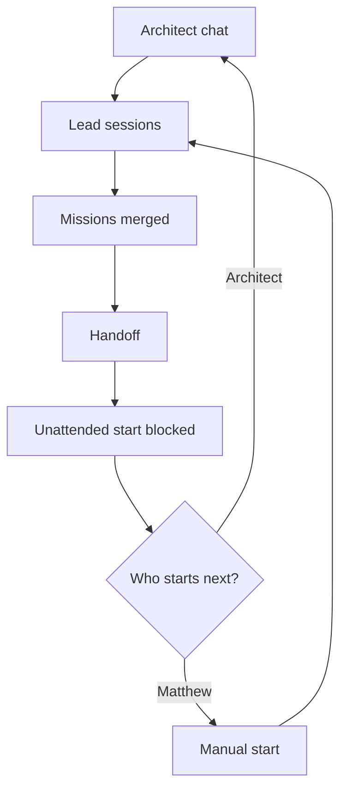

<h3>PR Summary by Qodo</h3>

Document M6 dress rehearsal results and successor-start blockers

<!-- qodo-describe-risk-badge -->
<!-- /qodo-describe-risk-badge -->
<code>📝 Documentation</code> <code>🕐 10-20 Minutes</code>

<!-- qodo-describe-risk-slot -->

AI Description

<dl>
<dd>
 

><pre>
>• Mark M5 and M6 complete and record the pet-todo rehearsal results.
>• Document findings L–P on scheduled sessions, notifications, environments, and watchdog
>  reliability.
>• Leave successor-start ownership as an explicit decision for Matthew.
></pre>

</dd>
</dl>

Diagram

<dl>
<dd>

 

</dd>
</dl>

High-Level Assessment

<dl>
<dd>

 

>Recording the findings, checks, and open decision in BUILD-STATE.md keeps the build&#x27;s operational record together. A separate rehearsal report would split information needed to resume the build without resolving the successor-start decision.

</dd>
</dl>

 Files changed (1) <code> +26 / -2 </code> 

<dl>
<dd>

 

Documentation (1) <code> +26 / -2 </code>

<dl>
<dd>

BUILD-STATE.md<code>Record M6 outcomes and platform findings</code> <code>+26/-2</code>

 

>Record M6 outcomes and platform findings
>
><pre>
>• Marks M5 and M6 done, adds findings L–P and assumption A-8, and tabulates the pet-todo rehearsal&#x27;s passes, partial results, failures, and unrun drills. Documents Matthew&#x27;s open choice between architect-led and manual successor starts.
></pre>
>
><a href='https://github.com/SigorMatt/agent-room/pull/10/files#diff-eb974eadcb2e1d4f382c2409c07a470b3df0574298ed8eda187eb1a6d7b1375f'>docs/design/BUILD-STATE.md</a>

</dd>
</dl>

</dd>
</dl>

<!-- qodo-describe-head:df910c393696d4a8a3157e83c2879d3c584c4c90 -->