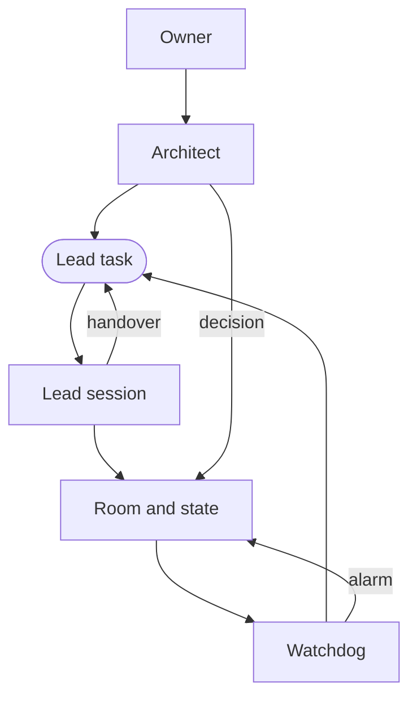

<h3>PR Summary by Qodo</h3>

Start leads through a reusable lead task and recover stalled rooms

<!-- qodo-describe-risk-badge -->
<!-- /qodo-describe-risk-badge -->
<code>✨ Enhancement</code> <code>🐞 Bug fix</code> <code>🧪 Tests</code> <code>📝 Documentation</code> <code>🕐 40+ Minutes</code>

<!-- qodo-describe-risk-slot -->

AI Description

<dl>
<dd>
 

><pre>
>• Start successor and takeover leads through a per-project API-triggered task, avoiding unavailable
>  scheduling tools.
>• Park leads awaiting owner decisions; let the architect or watchdog start their replacements.
>• Add start guards, bounded watchdog retries, operational guidance, and offline regression tests.
></pre>

</dd>
</dl>

Diagram

<dl>
<dd>

 

</dd>
</dl>

High-Level Assessment

<dl>
<dd>

 

>The following are alternative approaches to this PR:

<b>1. Architect chat as dispatcher</b>

<dl>
<dd>

- ➕ Uses an established scheduling path without a per-project API token.
- ➖ Starts can wait for check-ins or owner approval and depend on the architect chat.

</dd>
</dl>

<b>2. GitHub-triggered lead task</b>

<dl>
<dd>

- ➕ Avoids storing a task-fire token in the shared environment.
- ➖ Requires GitHub App setup and can launch unwanted runs from unrelated issue events.

</dd>
</dl>

>**Recommendation:** Keep the reusable API-triggered task: it launches promptly in the configured cloud environment without requiring scheduling tools in lead sessions. Its beta API and environment-readable token warrant continued attention; the prompt restriction, token handling, lease guards, and takeover limits are central to making this choice workable.

</dd>
</dl>

 Files changed (37) <code> +2496 / -231 </code> 

<dl>
<dd>

 

Enhancement (1) <code> +512 / -50 </code>

<dl>
<dd>

room.py<code>Implement guarded task firing and watchdog-led recovery</code> <code>+512/-50</code>

 

>Implement guarded task firing and watchdog-led recovery
>
><pre>
>• Adds lead-task-prompt and start-lead with configuration, lease, room, pin, recent-start, API-response, and token-scrubbing checks. Extends the watchdog with bounded stall episodes, takeover and decision starts, alarm caps, and --no-start; updates preflight and handoff guidance.
></pre>
>
><a href='https://github.com/SigorMatt/agent-room/pull/11/files#diff-36e706accba1fe5812fd1526e9931f792f8e314ada3f00e0e24e85cd44fb2433'>room.py</a>

</dd>
</dl>

Tests (3) <code> +1200 / -7 </code>

<dl>
<dd>

fake_curl.py<code>Simulate the lead-task fire endpoint offline</code> <code>+44/-6</code>

 

>Simulate the lead-task fire endpoint offline
>
><pre>
>• Separates fire requests from buzzes and provides configurable HTTP responses, failures, and session identifiers.
></pre>
>
><a href='https://github.com/SigorMatt/agent-room/pull/11/files#diff-0639438a16b9ca7e2a81e463679fae183f15b159f2f1bdf58a42e0af136969a7'>tests/fake_curl.py</a>

test_relay.py<code>Cover lead relay and stall recovery end to end</code> <code>+1149/-0</code>

 

>Cover lead relay and stall recovery end to end
>
><pre>
>• Exercises task prompts, authenticated starts, guards, token secrecy, handoffs, watchdog decisions and takeover episodes, alarm caps, and preflight against offline GitHub and curl fakes.
></pre>
>
><a href='https://github.com/SigorMatt/agent-room/pull/11/files#diff-a0d9c5597c09639d66b5bd40d242cb7b6b7788b88fa40d17157c9d608275a2e8'>tests/test_relay.py</a>

test_unattended.py<code>Update parked-lead watchdog expectations</code> <code>+7/-1</code>

 

>Update parked-lead watchdog expectations
>
><pre>
>• Releases the lease in existing waiting-for-owner cases so they continue to test genuinely parked leads.
></pre>
>
><a href='https://github.com/SigorMatt/agent-room/pull/11/files#diff-e8979e04ded6c8867ec6447b800c99d06550dde3347fd28f96aaf2ac0105288a'>tests/test_unattended.py</a>

</dd>
</dl>

Documentation (33) <code> +784 / -174 </code>

<dl>
<dd>

ARCHITECT.md<code>Assign lead-task setup and recovery to the architect</code> <code>+108/-49</code>

 

>Assign lead-task setup and recovery to the architect
>
><pre>
>• Describes task creation, first-lead and post-decision starts, manual recovery, and deletion of the watchdog at DONE. Adds safeguards for recent starts, task recreation, account moves, and accepted version pins.
></pre>
>
><a href='https://github.com/SigorMatt/agent-room/pull/11/files#diff-ea2e7d73022c92135dc25cc66e267892824f32ecb823bb758697588c630d9cc1'>ARCHITECT.md</a>

CHANGELOG.md<code>Record the lead-task lifecycle and migration</code> <code>+4/-1</code>

 

>Record the lead-task lifecycle and migration
>
><pre>
>• Lists API-triggered starts, watchdog recovery, parking, and the first-kickoff setup requirement.
></pre>
>
><a href='https://github.com/SigorMatt/agent-room/pull/11/files#diff-06572a96a58dc510037d5efa622f9bec8519bc1beab13c9f251e97e657a9d4ed'>CHANGELOG.md</a>

LEAD.md<code>Replace lead scheduling with handover and parking</code> <code>+60/-34</code>

 

>Replace lead scheduling with handover and parking
>
><pre>
>• Leads start successors with start-lead, release the lease when waiting only on the owner, and read room messages at work boundaries. Updates recovery of parked builder questions and leaves watchdog deletion to the architect.
></pre>
>
><a href='https://github.com/SigorMatt/agent-room/pull/11/files#diff-0d7d95c154bdf0eaee1f65e13b353b2c0c4950ddce9c78849fbf72025b313c79'>LEAD.md</a>

README.md<code>Introduce the lead task in the project overview</code> <code>+4/-2</code>

 

>Introduce the lead task in the project overview
>
><pre>
>• Adds the reusable task, the watchdog&#x27;s takeover role, and the start-lead command.
></pre>
>
><a href='https://github.com/SigorMatt/agent-room/pull/11/files#diff-b335630551682c19a781afebcf4d07bf978fb1f8ac04c6bf87428ed5106870f5'>README.md</a>

auditor.md<code>Keep environment secrets out of auditor output</code> <code>+1/-1</code>

 

>Keep environment secrets out of auditor output
>
><pre>
>• Forbids printing, logging, committing, or reporting environment values and tokens.
></pre>
>
><a href='https://github.com/SigorMatt/agent-room/pull/11/files#diff-fc70ffa51c0e9c9a0137c10d9f247bba64bcf7ed4f613606a0634c5ddec70b0f'>briefs/auditor.md</a>

builder.md<code>Constrain builder access to environment tokens</code> <code>+1/-0</code>

 

>Constrain builder access to environment tokens
>
><pre>
>• Prohibits secret disclosure and use of environment tokens not named by the task.
></pre>
>
><a href='https://github.com/SigorMatt/agent-room/pull/11/files#diff-89a2207eb531d8cc7587d7e27daedced5a5832a723891b3a1ed9716f712d7aaf'>briefs/builder.md</a>

cold-review.md<code>Prevent secrets entering committed cold reports</code> <code>+2/-0</code>

 

>Prevent secrets entering committed cold reports
>
><pre>
>• Requires reviewers to describe leaks without copying token values into reports or replies.
></pre>
>
><a href='https://github.com/SigorMatt/agent-room/pull/11/files#diff-45daae275277e9c59d041029852d2fae74eb2f0eb4bb3b9bba13cfb4332eb2b9'>briefs/cold-review.md</a>

planner.md<code>Exclude secrets from planner reports</code> <code>+1/-1</code>

 

>Exclude secrets from planner reports
>
><pre>
>• Adds a restriction against printing or recording environment values and tokens.
></pre>
>
><a href='https://github.com/SigorMatt/agent-room/pull/11/files#diff-d78af491cad7e68773869a464170dfd4f96d80e8e37b62ed86ff823d6f56d90e'>briefs/planner.md</a>

qodo-reader.md<code>Exclude secrets from Qodo-reader proposals</code> <code>+1/-1</code>

 

>Exclude secrets from Qodo-reader proposals
>
><pre>
>• Extends the reader&#x27;s restrictions to environment values, tokens, proposals, and replies.
></pre>
>
><a href='https://github.com/SigorMatt/agent-room/pull/11/files#diff-80344ae0568fb4564885799503996dc02c0c87b0485ae8a5b929e6f3cf99eb5e'>briefs/qodo-reader.md</a>

survey.md<code>Prevent environment-value disclosure in surveys</code> <code>+1/-1</code>

 

>Prevent environment-value disclosure in surveys
>
><pre>
>• Expands the survey&#x27;s existing secret-handling rule to environment variables and logs.
></pre>
>
><a href='https://github.com/SigorMatt/agent-room/pull/11/files#diff-d3c8eaeb6fa550717fd87047d4342e84343884d10239787568920657a6d794e8'>briefs/survey.md</a>

BUILD-STATE.md<code>Record the M6b decision and rehearsal context</code> <code>+34/-5</code>

 

>Record the M6b decision and rehearsal context
>
><pre>
>• Adds lead-relay and rehearsal milestones, owner to-dos, platform findings, and evaluated successor-start alternatives.
></pre>
>
><a href='https://github.com/SigorMatt/agent-room/pull/11/files#diff-eb974eadcb2e1d4f382c2409c07a470b3df0574298ed8eda187eb1a6d7b1375f'>docs/design/BUILD-STATE.md</a>

m6b-lead-relay.md<code>Specify API-triggered lead relay</code> <code>+220/-0</code>

 

>Specify API-triggered lead relay
>
><pre>
>• Defines task setup, start-lead outcomes and guards, watchdog recovery, parking protocols, manual changes, and offline acceptance tests.
></pre>
>
><a href='https://github.com/SigorMatt/agent-room/pull/11/files#diff-4755afc5e49c556fe6d328d642c88ec59ca9422b905c706f89172c428cc22aa6'>docs/design/m6b-lead-relay.md</a>

v1.md<code>Mark the original scheduling design as superseded</code> <code>+2/-0</code>

 

>Mark the original scheduling design as superseded
>
><pre>
>• Points readers to M6b for the replacement lead-task and parking lifecycle.
></pre>
>
><a href='https://github.com/SigorMatt/agent-room/pull/11/files#diff-2b52e99c393c109f0060898a48e99b807bac479fa6f867b8e9b985ed76357204'>docs/design/v1.md</a>

README.md<code>Index lead-task setup for owners</code> <code>+2/-1</code>

 

>Index lead-task setup for owners
>
><pre>
>• Links the new setup guide and notes that some setup requires a computer browser.
></pre>
>
><a href='https://github.com/SigorMatt/agent-room/pull/11/files#diff-5ff0bdf99e041da1e590db1f6b392ac119e5b981ebd320bc1afa73174e7f0424'>docs/manual/README.md</a>

answer-a-buzz.md<code>Explain starts after decisions and stall alarms</code> <code>+28/-31</code>

 

>Explain starts after decisions and stall alarms
>
><pre>
>• Revises escalation, handover-failure, and LEAD-SILENT responses around parked leads and watchdog takeovers.
></pre>
>
><a href='https://github.com/SigorMatt/agent-room/pull/11/files#diff-d3a70a640b14f1436419811a13d5e127a067c49ce42446d9f02bf5cbe82b2419'>docs/manual/answer-a-buzz.md</a>

change-something-mid-build.md<code>Set ACK expectations without scheduled check-ins</code> <code>+3/-2</code>

 

>Set ACK expectations without scheduled check-ins
>
><pre>
>• Explains that running leads read changes at work boundaries and parked leads need a new session.
></pre>
>
><a href='https://github.com/SigorMatt/agent-room/pull/11/files#diff-369bb6f3459db17b6117ab349e7325150d7a4dce4df2ddd3bb8146df908e6fd8'>docs/manual/change-something-mid-build.md</a>

create-the-cloud-environment.md<code>Document the per-project fire-token variable</code> <code>+2/-1</code>

 

>Document the per-project fire-token variable
>
><pre>
>• Identifies the lead-task token as an environment variable added at kickoff.
></pre>
>
><a href='https://github.com/SigorMatt/agent-room/pull/11/files#diff-66b0fc08934275ec3c4bae3d4f28a35e81ba259ebabc3f7bb83090a7e87915c0'>docs/manual/create-the-cloud-environment.md</a>

files-and-owners.md<code>Assign ownership of lead tasks and watchdogs</code> <code>+3/-1</code>

 

>Assign ownership of lead tasks and watchdogs
>
><pre>
>• Adds their locations and owners, and identifies both task IDs in PLAYBOOK.md.
></pre>
>
><a href='https://github.com/SigorMatt/agent-room/pull/11/files#diff-f47b2b54518102b933d7e64a9a1b8f5d81f1c27151b2e8c3f08f2d1e0fc8180f'>docs/manual/files-and-owners.md</a>

fix-preflight.md<code>Add lead-task and pin preflight remedies</code> <code>+2/-0</code>

 

>Add lead-task and pin preflight remedies
>
><pre>
>• Explains how to resolve missing task configuration and version pins the task prompt rejects.
></pre>
>
><a href='https://github.com/SigorMatt/agent-room/pull/11/files#diff-70474326c08096752223a06cfb28f4179eb1b2f1799e2c51d84204fccc07ec9c'>docs/manual/fix-preflight.md</a>

glossary.md<code>Define parking and the new lead lifecycle</code> <code>+6/-4</code>

 

>Define parking and the new lead lifecycle
>
><pre>
>• Adds the lead task and parked-lead concepts while replacing check-in terminology.
></pre>
>
><a href='https://github.com/SigorMatt/agent-room/pull/11/files#diff-ab49e26773cd11b72502ca499f805f8e87462242295c83306982316c497a2c7f'>docs/manual/glossary.md</a>

kick-off-a-phase.md<code>Move first-lead launch into kickoff</code> <code>+9/-8</code>

 

>Move first-lead launch into kickoff
>
><pre>
>• Directs the owner to create the task once and approve the architect&#x27;s first start if prompted.
></pre>
>
><a href='https://github.com/SigorMatt/agent-room/pull/11/files#diff-e53a7e559d2c268d2a27b08a3353ce0730b95cdee1237f8611c589eb4703788b'>docs/manual/kick-off-a-phase.md</a>

message-kinds.md<code>Document LEAD-STARTED and revised alarms</code> <code>+4/-3</code>

 

>Document LEAD-STARTED and revised alarms
>
><pre>
>• Defines the non-buzzing start message and distinguishes decision starts from takeovers.
></pre>
>
><a href='https://github.com/SigorMatt/agent-room/pull/11/files#diff-09cb0a2e151eb8b9ccf8fcf259fac66b6f8b7bac0b9ac7fbf08a92c6668fd328'>docs/manual/message-kinds.md</a>

move-a-project-to-the-other-account.md<code>Recreate lead-task credentials after an account move</code> <code>+7/-5</code>

 

>Recreate lead-task credentials after an account move
>
><pre>
>• Adds task setup, replacement playbook ID, and architect-led launch in the destination account.
></pre>
>
><a href='https://github.com/SigorMatt/agent-room/pull/11/files#diff-ea789efa04a80b7638a4742f6e41f3d90120b1f7a17e8ecbfadabfc132841283'>docs/manual/move-a-project-to-the-other-account.md</a>

set-up-the-lead-task.md<code>Add browser walkthrough for the reusable lead task</code> <code>+75/-0</code>

 

>Add browser walkthrough for the reusable lead task
>
><pre>
>• Guides the owner through task creation, API trigger configuration, and secure placement of its per-repo token.
></pre>
>
><a href='https://github.com/SigorMatt/agent-room/pull/11/files#diff-29845b42fda29f72f7c23d1850e606c301364b96400cf9d0b4df95d552a1a580'>docs/manual/set-up-the-lead-task.md</a>

start-a-new-phase.md<code>Reuse the lead task across phases</code> <code>+2/-2</code>

 

>Reuse the lead task across phases
>
><pre>
>• Clarifies that a new phase gets a room and watchdog while the architect starts its first lead through the existing task.
></pre>
>
><a href='https://github.com/SigorMatt/agent-room/pull/11/files#diff-285ad703cd2573cf711110e8c3ab6bd3b08ce5e94c68d201531efae98862576e'>docs/manual/start-a-new-phase.md</a>

start-the-next-lead-by-hand.md<code>Make Run now the primary manual start path</code> <code>+14/-6</code>

 

>Make Run now the primary manual start path
>
><pre>
>• Explains how to pass the join line to the lead task, with a Code-tab fallback and takeover precautions.
></pre>
>
><a href='https://github.com/SigorMatt/agent-room/pull/11/files#diff-294f11d2c7ddbfe0d2f72e13a052c6475345433ac8485de5ec27469ed827fd77'>docs/manual/start-the-next-lead-by-hand.md</a>

steer-from-github.md<code>Adjust owner steering to boundary-based room reads</code> <code>+4/-2</code>

 

>Adjust owner steering to boundary-based room reads
>
><pre>
>• Replaces check-in timing advice and directs owners to the architect when a parked lead cannot read a comment.
></pre>
>
><a href='https://github.com/SigorMatt/agent-room/pull/11/files#diff-b2a7cfa50633b9936ed7de2de54d861c00263d40b35edf881c4b4c94b68fee3a'>docs/manual/steer-from-github.md</a>

stop-or-pause.md<code>Route pause and resume through the architect</code> <code>+12/-5</code>

 

>Route pause and resume through the architect
>
><pre>
>• Explains how a parked lead answers STOP or PAUSE and why only the architect restarts a halted room.
></pre>
>
><a href='https://github.com/SigorMatt/agent-room/pull/11/files#diff-389465ea269a845490df59482a40f4cc1ec6d5e684754f35eba1781d11caac47'>docs/manual/stop-or-pause.md</a>

troubleshooting.md<code>Add lead-start and deleted-task recovery paths</code> <code>+17/-6</code>

 

>Add lead-start and deleted-task recovery paths
>
><pre>
>• Covers stalled starts, final takeover alarms, token failures, and recreating a deleted lead task.
></pre>
>
><a href='https://github.com/SigorMatt/agent-room/pull/11/files#diff-bfec8ea3d3009f9d7d15f1153d8a9db48d7c0e60aa0343ad065af35765dbc2e4'>docs/manual/troubleshooting.md</a>

upgrade-a-project.md<code>Have the architect restart leads after upgrades</code> <code>+8/-2</code>

 

>Have the architect restart leads after upgrades
>
><pre>
>• Replaces owner-led launch instructions with an architect task start and manual fallback.
></pre>
>
><a href='https://github.com/SigorMatt/agent-room/pull/11/files#diff-223e997fc73050942a003e4dde0ae6d39108c325aaebf12a65f8d86367b793ea'>docs/manual/upgrade-a-project.md</a>

DISPOSITIONS.md<code>Record M6b cold-review resolutions</code> <code>+24/-0</code>

 

>Record M6b cold-review resolutions
>
><pre>
>• Tracks both rounds&#x27; findings, fixes, and regression evidence under the gate-compatible M6 directory.
></pre>
>
><a href='https://github.com/SigorMatt/agent-room/pull/11/files#diff-639a775ebd6e1ae6af29a31d15e9fcef00d166aca6921d8ed36db04ca7cc519d'>reviews/cold/M6/DISPOSITIONS.md</a>

round-1.md<code>Archive the first M6b cold review</code> <code>+56/-0</code>

 

>Archive the first M6b cold review
>
><pre>
>• Records twelve findings and assesses implementation, protocol, manual, and test coverage.
></pre>
>
><a href='https://github.com/SigorMatt/agent-room/pull/11/files#diff-e9d476f2881aff621b68cec3fb86e087de3a2cc32a0641331e7b975457299c26'>reviews/cold/M6/round-1.md</a>

round-2.md<code>Archive the second M6b cold review</code> <code>+67/-0</code>

 

>Archive the second M6b cold review
>
><pre>
>• Records six follow-up findings, earlier-fix checks, and remaining scope observations.
></pre>
>
><a href='https://github.com/SigorMatt/agent-room/pull/11/files#diff-ba923dc65825cb9a627ea2b43af1d25c3e0486a4b7cb50a67fa2df7799ecccfc'>reviews/cold/M6/round-2.md</a>

</dd>
</dl>

</dd>
</dl>

<!-- qodo-describe-head:cde42bac28cebb6f54ade74bed236467aef6e605 -->