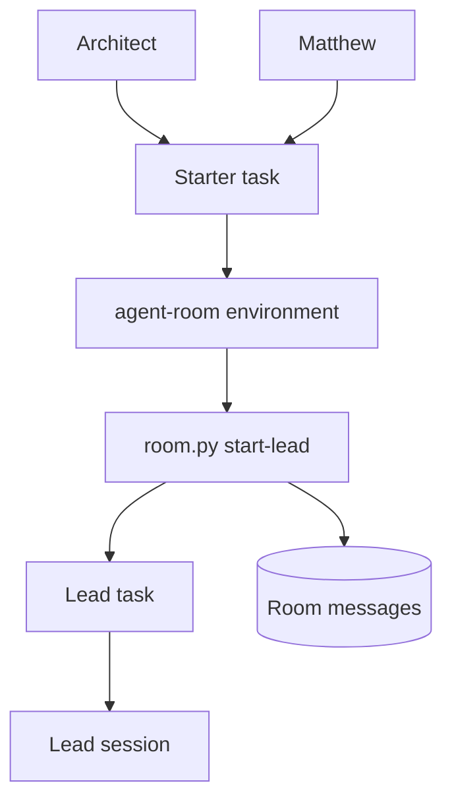

<h3>PR Summary by Qodo</h3>

Document starter tasks for architect-initiated leads

<!-- qodo-describe-risk-badge -->
<!-- /qodo-describe-risk-badge -->
<code>📝 Documentation</code> <code>🕐 20-40 Minutes</code>

<!-- qodo-describe-risk-slot -->

AI Description

<dl>
<dd>
 

><pre>
>• Replace the architect’s unavailable fire action with one-time starter tasks that run <b><i>start-lead</i></b>.
>• Preserve manual lead starts when a starter task cannot be created or fails.
>• Align the architect protocol, owner manuals, design records, and changelog with the new procedure.
></pre>

</dd>
</dl>

Diagram

<dl>
<dd>

 

</dd>
</dl>

High-Level Assessment

<dl>
<dd>

 

>Keep the documented starter-task approach: it uses the existing guarded `start-lead` command without changing the web-created lead task. Direct `fire_trigger` is unavailable to the architect, while manual Run now and Code-tab starts remain appropriate fallbacks.

</dd>
</dl>

 Files changed (12) <code> +60 / -38 </code> 

<dl>
<dd>

 

Documentation (12) <code> +60 / -38 </code>

<dl>
<dd>

ARCHITECT.md<code>Define starter-task creation and lead-start recovery</code> <code>+41/-23</code>

 

>Define starter-task creation and lead-start recovery
>
><pre>
>• Adds the one-time task prompt and applies it to kickoff, decisions, resumes, and takeovers. Retains manual fallbacks, clarifies who posts &#x27;LEAD-STARTED&#x27;, and prohibits deleting starter tasks.
></pre>
>
><a href='https://github.com/SigorMatt/agent-room/pull/12/files#diff-ea2e7d73022c92135dc25cc66e267892824f32ecb823bb758697588c630d9cc1'>ARCHITECT.md</a>

CHANGELOG.md<code>Record the starter-task lead-start procedure</code> <code>+2/-1</code>

 

>Record the starter-task lead-start procedure
>
><pre>
>• Explains why architect-initiated starts use one-time tasks and identifies the manual fallbacks.
></pre>
>
><a href='https://github.com/SigorMatt/agent-room/pull/12/files#diff-06572a96a58dc510037d5efa622f9bec8519bc1beab13c9f251e97e657a9d4ed'>CHANGELOG.md</a>

BUILD-STATE.md<code>Record finding T on task-fire permissions</code> <code>+1/-0</code>

 

>Record finding T on task-fire permissions
>
><pre>
>• Documents the failed &#x27;fire_trigger&#x27; attempt on a web-created task and the starter-task workaround used for M6c’s first lead.
></pre>
>
><a href='https://github.com/SigorMatt/agent-room/pull/12/files#diff-eb974eadcb2e1d4f382c2409c07a470b3df0574298ed8eda187eb1a6d7b1375f'>docs/design/BUILD-STATE.md</a>

m6b-lead-relay.md<code>Align the M6b design with starter tasks</code> <code>+6/-6</code>

 

>Align the M6b design with starter tasks
>
><pre>
>• Replaces fire-action instructions for architect-initiated starts with the one-time starter-task procedure and its fallback.
></pre>
>
><a href='https://github.com/SigorMatt/agent-room/pull/12/files#diff-4755afc5e49c556fe6d328d642c88ec59ca9422b905c706f89172c428cc22aa6'>docs/design/m6b-lead-relay.md</a>

answer-a-buzz.md<code>Clarify approvals for decision and takeover starts</code> <code>+2/-2</code>

 

>Clarify approvals for decision and takeover starts
>
><pre>
>• Tells Matthew to approve the starter task when the architect starts a lead after a decision or a stalled lead.
></pre>
>
><a href='https://github.com/SigorMatt/agent-room/pull/12/files#diff-d3a70a640b14f1436419811a13d5e127a067c49ce42446d9f02bf5cbe82b2419'>docs/manual/answer-a-buzz.md</a>

glossary.md<code>Define starter task</code> <code>+1/-0</code>

 

>Define starter task
>
><pre>
>• Adds its purpose, naming convention, one-time behavior, and instruction not to delete it.
></pre>
>
><a href='https://github.com/SigorMatt/agent-room/pull/12/files#diff-ab49e26773cd11b72502ca499f805f8e87462242295c83306982316c497a2c7f'>docs/manual/glossary.md</a>

kick-off-a-phase.md<code>Describe the first lead’s scheduled start</code> <code>+1/-1</code>

 

>Describe the first lead’s scheduled start
>
><pre>
>• Explains the starter-task approval and approximate delay before the first lead starts.
></pre>
>
><a href='https://github.com/SigorMatt/agent-room/pull/12/files#diff-e53a7e559d2c268d2a27b08a3353ce0730b95cdee1237f8611c589eb4703788b'>docs/manual/kick-off-a-phase.md</a>

move-a-project-to-the-other-account.md<code>Update account-move lead-start instructions</code> <code>+1/-1</code>

 

>Update account-move lead-start instructions
>
><pre>
>• Specifies that the architect creates a starter task in the other account and Matthew approves it.
></pre>
>
><a href='https://github.com/SigorMatt/agent-room/pull/12/files#diff-ea789efa04a80b7638a4742f6e41f3d90120b1f7a17e8ecbfadabfc132841283'>docs/manual/move-a-project-to-the-other-account.md</a>

start-the-next-lead-by-hand.md<code>Distinguish starter tasks from manual lead starts</code> <code>+2/-2</code>

 

>Distinguish starter tasks from manual lead starts
>
><pre>
>• Explains that the architect normally uses a starter task and that Matthew starts a lead by hand only when asked.
></pre>
>
><a href='https://github.com/SigorMatt/agent-room/pull/12/files#diff-294f11d2c7ddbfe0d2f72e13a052c6475345433ac8485de5ec27469ed827fd77'>docs/manual/start-the-next-lead-by-hand.md</a>

stop-or-pause.md<code>Update the resume procedure</code> <code>+1/-1</code>

 

>Update the resume procedure
>
><pre>
>• Directs Matthew to approve the architect’s starter task when resuming a paused or stopped room.
></pre>
>
><a href='https://github.com/SigorMatt/agent-room/pull/12/files#diff-389465ea269a845490df59482a40f4cc1ec6d5e684754f35eba1781d11caac47'>docs/manual/stop-or-pause.md</a>

troubleshooting.md<code>Explain inactive starter tasks</code> <code>+1/-0</code>

 

>Explain inactive starter tasks
>
><pre>
>• Adds guidance to leave completed starter tasks intact because deleting one deletes its session.
></pre>
>
><a href='https://github.com/SigorMatt/agent-room/pull/12/files#diff-bfec8ea3d3009f9d7d15f1153d8a9db48d7c0e60aa0343ad065af35765dbc2e4'>docs/manual/troubleshooting.md</a>

upgrade-a-project.md<code>Update post-upgrade lead-start instructions</code> <code>+1/-1</code>

 

>Update post-upgrade lead-start instructions
>
><pre>
>• Describes starter-task approval when the architect resumes a lead after an upgrade.
></pre>
>
><a href='https://github.com/SigorMatt/agent-room/pull/12/files#diff-223e997fc73050942a003e4dde0ae6d39108c325aaebf12a65f8d86367b793ea'>docs/manual/upgrade-a-project.md</a>

</dd>
</dl>

</dd>
</dl>

<!-- qodo-describe-head:c96a526507d6303f85a17b5eeacbb9d26955ecb3 -->