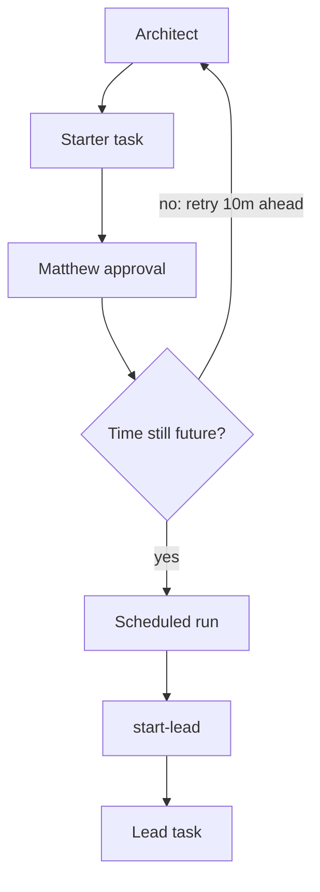

<h3>PR Summary by Qodo</h3>

Document M6c rehearsal and delayed starter-task approvals

<!-- qodo-describe-risk-badge -->
<!-- /qodo-describe-risk-badge -->
<code>📝 Documentation</code> <code>🕐 20-40 Minutes</code>

AI Description

<dl>
<dd>
 

><pre>
>• Record M6c rehearsal outcomes, including unattended handovers, takeover, and findings T–V.
>• Schedule starter tasks 10 minutes ahead and retry creation when approval arrives too late.
>• Tell Matthew when to expect starter-task approval pop-ups, including possible second requests.
></pre>

</dd>
</dl>

<!-- qodo-describe-risk-slot -->

Diagram

<dl>
<dd>

 

</dd>
</dl>

High-Level Assessment

<dl>
<dd>

 

>Keep the documented starter-task approach: agents cannot fire Matthew’s web-created task directly, while a manual start would require more owner intervention. Scheduling ahead and recreating an expired request addresses the observed approval delay without changing the tested handover mechanism.

</dd>
</dl>

 Files changed (6) <code> +30 / -9 </code> 

<dl>
<dd>

 

Documentation (6) <code> +30 / -9 </code>

<dl>
<dd>

ARCHITECT.md<code>Allow more time for starter-task approval</code> <code>+5/-3</code>

 

>Allow more time for starter-task approval
>
><pre>
>• Directs the architect to schedule starter tasks 10 minutes ahead, announce the approval pop-up, and recreate a task if late approval makes its start time invalid. Aligns the first-lead kickoff timing with that schedule.
></pre>
>
><a href='https://github.com/SigorMatt/agent-room/pull/13/files#diff-ea2e7d73022c92135dc25cc66e267892824f32ecb823bb758697588c630d9cc1'>ARCHITECT.md</a>

BUILD-STATE.md<code>Record M6c results and platform findings</code> <code>+20/-1</code>

 

>Record M6c results and platform findings
>
><pre>
>• Marks the phase-two rehearsal complete and records its handovers, takeover, escalation, change request, approvals, and untested paths. Adds findings on web-created task firing, expired starter-task times, and the potential for PushNotification to replace ntfy.
></pre>
>
><a href='https://github.com/SigorMatt/agent-room/pull/13/files#diff-eb974eadcb2e1d4f382c2409c07a470b3df0574298ed8eda187eb1a6d7b1375f'>docs/design/BUILD-STATE.md</a>

answer-a-buzz.md<code>Clarify approval timing after decisions and alarms</code> <code>+2/-2</code>

 

>Clarify approval timing after decisions and alarms
>
><pre>
>• Tells Matthew to approve starter-task pop-ups when they appear, warns that late approval may require a second request, and updates the expected takeover-start delay to about 10 minutes.
></pre>
>
><a href='https://github.com/SigorMatt/agent-room/pull/13/files#diff-d3a70a640b14f1436419811a13d5e127a067c49ce42446d9f02bf5cbe82b2419'>docs/manual/answer-a-buzz.md</a>

glossary.md<code>Clarify the starter-task approval entry</code> <code>+1/-1</code>

 

>Clarify the starter-task approval entry
>
><pre>
>• Updates the starter-task definition to explain prompt approval and the possibility of a second pop-up after a delay.
></pre>
>
><a href='https://github.com/SigorMatt/agent-room/pull/13/files#diff-ab49e26773cd11b72502ca499f805f8e87462242295c83306982316c497a2c7f'>docs/manual/glossary.md</a>

kick-off-a-phase.md<code>Update first-lead kickoff expectations</code> <code>+1/-1</code>

 

>Update first-lead kickoff expectations
>
><pre>
>• Changes the expected starter-task delay from two to about 10 minutes and explains the announced pop-up and possible retry after late approval.
></pre>
>
><a href='https://github.com/SigorMatt/agent-room/pull/13/files#diff-e53a7e559d2c268d2a27b08a3353ce0730b95cdee1237f8611c589eb4703788b'>docs/manual/kick-off-a-phase.md</a>

start-the-next-lead-by-hand.md<code>Clarify approval for architect-started leads</code> <code>+1/-1</code>

 

>Clarify approval for architect-started leads
>
><pre>
>• Tells Matthew to approve the architect’s starter-task pop-up when it appears and notes that late approval may prompt a second request.
></pre>
>
><a href='https://github.com/SigorMatt/agent-room/pull/13/files#diff-294f11d2c7ddbfe0d2f72e13a052c6475345433ac8485de5ec27469ed827fd77'>docs/manual/start-the-next-lead-by-hand.md</a>

</dd>
</dl>

</dd>
</dl>

<!-- qodo-describe-head:262f3844e0849d300e0d046ce7794a60d35e4bd8 -->