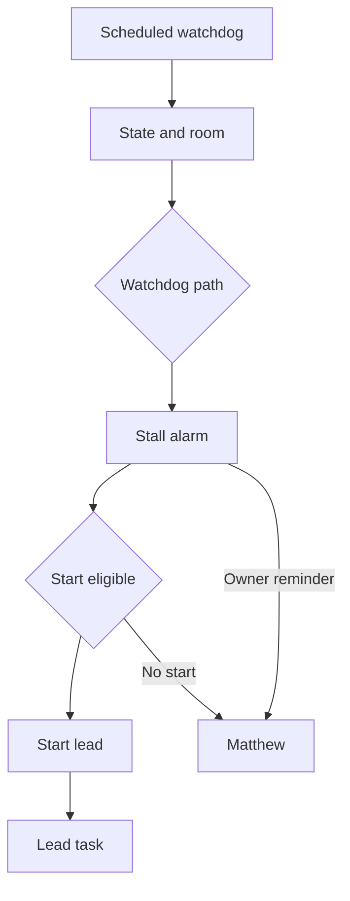

<h3>PR Summary by Qodo</h3>

Start one watchdog lead per stall and remind on unanswered requests

<!-- qodo-describe-risk-badge -->
<!-- /qodo-describe-risk-badge -->
<code>✨ Enhancement</code> <code>🐞 Bug fix</code> <code>🧪 Tests</code> <code>📝 Documentation</code> <code>🕐 40+ Minutes</code>

AI Description

<dl>
<dd>
 

><pre>
>• Start at most one lead per alarmed stall when no lead has recently posted or already started.
>• Remind Matthew about unanswered parked requests and retry failed state-unreadable reminders.
>• Add offline coverage and update operational guidance for watchdog starts and reminders.
></pre>

</dd>
</dl>

<!-- qodo-describe-risk-slot -->

Diagram

<dl>
<dd>

 

</dd>
</dl>

High-Level Assessment

<dl>
<dd>

 

>Keep the shared start-lead path and place the single start rule after the existing alarm logic. This limits new behavior to eligibility checks while retaining established start guards, posting retries, and deduplication; a separate watchdog-specific start implementation would duplicate those safeguards.

</dd>
</dl>

 Files changed (15) <code> +695 / -87 </code> 

<dl>
<dd>

 

Enhancement (1) <code> +121 / -50 </code>

<dl>
<dd>

room.py<code>Start eligible stalled leads and retry new reminders</code> <code>+121/-50</code>

 

>Start eligible stalled leads and retry new reminders
>
><pre>
>• Allows watchdog-authored LEAD-STARTED messages and uses the existing start-lead path after an alarm when no start or recent lead message blocks it. Adds reminders for unanswered parked requests and routes state-unreadable alarms through shared reminder and buzz-retry logic.
></pre>
>
><a href='https://github.com/SigorMatt/agent-room/pull/14/files#diff-36e706accba1fe5812fd1526e9931f792f8e314ada3f00e0e24e85cd44fb2433'>room.py</a>

</dd>
</dl>

Tests (2) <code> +454 / -12 </code>

<dl>
<dd>

test_m6d.py<code>Exercise watchdog starts and reminder timing offline</code> <code>+438/-0</code>

 

>Exercise watchdog starts and reminder timing offline
>
><pre>
>• Adds integration-style coverage for stall, decision, pre-start, and waiting-step starts, including duplicate prevention and failed starts. Tests parked-request reminder repetition, failed-buzz retries, and the state-unreadable reminder retry.
></pre>
>
><a href='https://github.com/SigorMatt/agent-room/pull/14/files#diff-10a12f480ba6023d4996392317913d37338946efcf394580742b9416cd5e4d70'>tests/test_m6d.py</a>

test_relay.py<code>Adapt relay tests to the watchdog’s new permissions</code> <code>+16/-12</code>

 

>Adapt relay tests to the watchdog’s new permissions
>
><pre>
>• Keeps existing alarm-focused tests from firing leads by removing their token, while updating role guards and message-permission expectations for watchdog starts.
></pre>
>
><a href='https://github.com/SigorMatt/agent-room/pull/14/files#diff-a0d9c5597c09639d66b5bd40d242cb7b6b7788b88fa40d17157c9d608275a2e8'>tests/test_relay.py</a>

</dd>
</dl>

Documentation (12) <code> +120 / -25 </code>

<dl>
<dd>

ARCHITECT.md<code>Explain watchdog starts and owner-wait reminders</code> <code>+13/-9</code>

 

>Explain watchdog starts and owner-wait reminders
>
><pre>
>• Updates buzz interpretation and lead-start instructions to account for the watchdog’s one start per stall. Tells the architect when to wait for a watchdog-started lead and when to intervene manually.
></pre>
>
><a href='https://github.com/SigorMatt/agent-room/pull/14/files#diff-ea2e7d73022c92135dc25cc66e267892824f32ecb823bb758697588c630d9cc1'>ARCHITECT.md</a>

CHANGELOG.md<code>Record M6d watchdog behavior</code> <code>+2/-1</code>

 

>Record M6d watchdog behavior
>
><pre>
>• Records automatic starts, parked-request reminders, and retries for failed state-unreadable reminders.
></pre>
>
><a href='https://github.com/SigorMatt/agent-room/pull/14/files#diff-06572a96a58dc510037d5efa622f9bec8519bc1beab13c9f251e97e657a9d4ed'>CHANGELOG.md</a>

LEAD.md<code>Adjust lead guidance for automatic takeovers</code> <code>+4/-4</code>

 

>Adjust lead guidance for automatic takeovers
>
><pre>
>• Revises parking and signs-of-life guidance now that the watchdog can start one takeover per stall and remind Matthew about unanswered requests.
></pre>
>
><a href='https://github.com/SigorMatt/agent-room/pull/14/files#diff-0d7d95c154bdf0eaee1f65e13b353b2c0c4950ddce9c78849fbf72025b313c79'>LEAD.md</a>

README.md<code>Summarize the watchdog’s expanded role</code> <code>+1/-1</code>

 

>Summarize the watchdog’s expanded role
>
><pre>
>• Updates the component overview to include parked-request reminders and one automatic start per stall.
></pre>
>
><a href='https://github.com/SigorMatt/agent-room/pull/14/files#diff-b335630551682c19a781afebcf4d07bf978fb1f8ac04c6bf87428ed5106870f5'>README.md</a>

BUILD-STATE.md<code>Record M6d decision and backlog completion</code> <code>+5/-3</code>

 

>Record M6d decision and backlog completion
>
><pre>
>• Adds M6d and Matthew’s decision to build B-5 and B-6 before M7, marks both items done, and records the finding that scheduled-task pushes do not arrive mid-run.
></pre>
>
><a href='https://github.com/SigorMatt/agent-room/pull/14/files#diff-eb974eadcb2e1d4f382c2409c07a470b3df0574298ed8eda187eb1a6d7b1375f'>docs/design/BUILD-STATE.md</a>

m6b-lead-relay.md<code>Link the earlier relay design to M6d</code> <code>+2/-0</code>

 

>Link the earlier relay design to M6d
>
><pre>
>• Adds a note directing readers of the alarm-only M6b design to the new watchdog specification.
></pre>
>
><a href='https://github.com/SigorMatt/agent-room/pull/14/files#diff-4755afc5e49c556fe6d328d642c88ec59ca9422b905c706f89172c428cc22aa6'>docs/design/m6b-lead-relay.md</a>

m6d-watchdog.md<code>Specify one start per stall and owner-wait reminders</code> <code>+83/-0</code>

 

>Specify one start per stall and owner-wait reminders
>
><pre>
>• Defines start eligibility, failure handling, reminder behavior, and expected tests for B-5 and B-6. Distinguishes stalls that may start a lead from parked requests that require Matthew’s decision.
></pre>
>
><a href='https://github.com/SigorMatt/agent-room/pull/14/files#diff-4914b07886c76009e1254a9f8a0538513802cd0d80f708bd9f1653e5e806a33c'>docs/design/m6d-watchdog.md</a>

answer-a-buzz.md<code>Explain how to respond to new watchdog messages</code> <code>+4/-3</code>

 

>Explain how to respond to new watchdog messages
>
><pre>
>• Describes automatic starts after stall alarms, unanswered-request reminders, and how to handle a lead that fails after the watchdog starts it.
></pre>
>
><a href='https://github.com/SigorMatt/agent-room/pull/14/files#diff-d3a70a640b14f1436419811a13d5e127a067c49ce42446d9f02bf5cbe82b2419'>docs/manual/answer-a-buzz.md</a>

glossary.md<code>Update the watchdog definition</code> <code>+1/-1</code>

 

>Update the watchdog definition
>
><pre>
>• Describes the watchdog’s owner-wait reminders and limited automatic lead starts.
></pre>
>
><a href='https://github.com/SigorMatt/agent-room/pull/14/files#diff-ab49e26773cd11b72502ca499f805f8e87462242295c83306982316c497a2c7f'>docs/manual/glossary.md</a>

message-kinds.md<code>Document watchdog-authored start messages</code> <code>+2/-2</code>

 

>Document watchdog-authored start messages
>
><pre>
>• Adds the watchdog as a possible LEAD-STARTED author and explains the new waiting-for-Matthew LEAD-SILENT reminder.
></pre>
>
><a href='https://github.com/SigorMatt/agent-room/pull/14/files#diff-09cb0a2e151eb8b9ccf8fcf259fac66b6f8b7bac0b9ac7fbf08a92c6668fd328'>docs/manual/message-kinds.md</a>

stop-or-pause.md<code>Clarify that halted rooms remain manual to resume</code> <code>+1/-1</code>

 

>Clarify that halted rooms remain manual to resume
>
><pre>
>• Specifies that the watchdog does not resume a paused or stopped build; the architect still handles resumption.
></pre>
>
><a href='https://github.com/SigorMatt/agent-room/pull/14/files#diff-389465ea269a845490df59482a40f4cc1ec6d5e684754f35eba1781d11caac47'>docs/manual/stop-or-pause.md</a>

troubleshooting.md<code>Add guidance for unanswered requests and failed watchdog leads</code> <code>+2/-0</code>

 

>Add guidance for unanswered requests and failed watchdog leads
>
><pre>
>• Adds troubleshooting entries for parked-request reminders and a second alarm after a watchdog-started lead.
></pre>
>
><a href='https://github.com/SigorMatt/agent-room/pull/14/files#diff-bfec8ea3d3009f9d7d15f1153d8a9db48d7c0e60aa0343ad065af35765dbc2e4'>docs/manual/troubleshooting.md</a>

</dd>
</dl>

</dd>
</dl>

<!-- qodo-describe-head:bc901b7bb45e50a86dc95aa3af100446c8faa6b6 -->