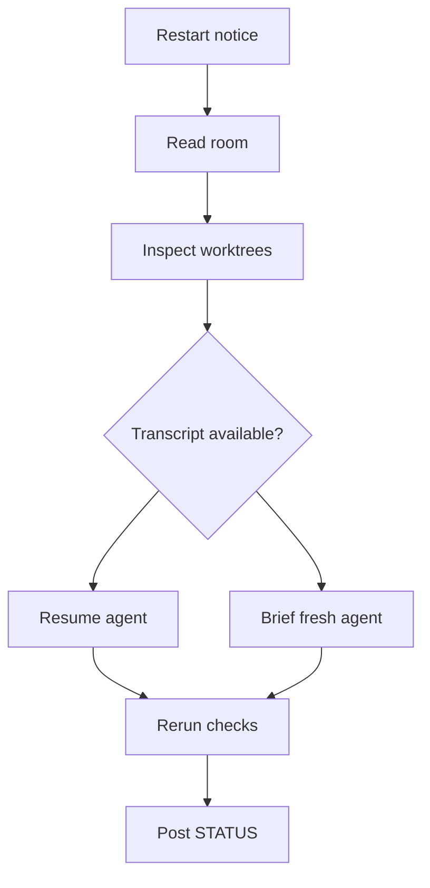

<h3>PR Summary by Qodo</h3>

Document lead recovery after container restarts

<!-- qodo-describe-risk-badge -->
<!-- /qodo-describe-risk-badge -->
<code>📝 Documentation</code> <code>🕐 20-40 Minutes</code>

AI Description

<dl>
<dd>
 

><pre>
>• Give leads a recovery procedure for stopped agents and commands after container restarts.
>• Preserve completed work and exclude restart interruptions from failed-attempt counts.
>• Record B-7’s completion and explain the restart status to owners.
></pre>

</dd>
</dl>

<!-- qodo-describe-risk-slot -->

Diagram

<dl>
<dd>

 

</dd>
</dl>

High-Level Assessment

<dl>
<dd>

 

>The documentation-only protocol fits an event that wakes the lead while leaving the room, lease, and state intact. Changing room.py or automatically resetting state would add risk without addressing the stopped subagents and commands the lead must assess.

</dd>
</dl>

 Files changed (5) <code> +80 / -5 </code> 

<dl>
<dd>

 

Documentation (5) <code> +80 / -5 </code>

<dl>
<dd>

CHANGELOG.md<code>Record M6e restart recovery</code> <code>+1/-0</code>

 

>Record M6e restart recovery
>
><pre>
>• Adds a release note describing the lead’s recovery procedure and clarifying that a container restart does not count as a failed attempt.
></pre>
>
><a href='https://github.com/SigorMatt/agent-room/pull/15/files#diff-06572a96a58dc510037d5efa622f9bec8519bc1beab13c9f251e97e657a9d4ed'>CHANGELOG.md</a>

LEAD.md<code>Define the lead’s post-restart procedure</code> <code>+20/-3</code>

 

>Define the lead’s post-restart procedure
>
><pre>
>• Directs the lead to read the room, inspect stopped agents’ worktrees, resume or replace agents, rerun interrupted waits, and post a status without repeating completed work. Clarifies attempt accounting and links the delegation rule to this procedure.
></pre>
>
><a href='https://github.com/SigorMatt/agent-room/pull/15/files#diff-0d7d95c154bdf0eaee1f65e13b353b2c0c4950ddce9c78849fbf72025b313c79'>LEAD.md</a>

BUILD-STATE.md<code>Track M6e and mark B-7 complete</code> <code>+4/-2</code>

 

>Track M6e and mark B-7 complete
>
><pre>
>• Adds the M6e milestone and assumption A-13, connects finding W to the new spec, and records B-7 as done.
></pre>
>
><a href='https://github.com/SigorMatt/agent-room/pull/15/files#diff-eb974eadcb2e1d4f382c2409c07a470b3df0574298ed8eda187eb1a6d7b1375f'>docs/design/BUILD-STATE.md</a>

m6e-restarts.md<code>Specify the M6e restart-recovery scope</code> <code>+54/-0</code>

 

>Specify the M6e restart-recovery scope
>
><pre>
>• Documents what survives and stops during a container restart, the intended lead procedure, and the work excluded from this docs-only change.
></pre>
>
><a href='https://github.com/SigorMatt/agent-room/pull/15/files#diff-b5cc2cefcb4d6374b27da69b65445359bb5f96a4f388b71441528fea150959a0'>docs/design/m6e-restarts.md</a>

troubleshooting.md<code>Explain restart statuses to owners</code> <code>+1/-0</code>

 

>Explain restart statuses to owners
>
><pre>
>• Adds a troubleshooting row explaining that a restart status requires no owner action because the room, lease, and state remain unchanged.
></pre>
>
><a href='https://github.com/SigorMatt/agent-room/pull/15/files#diff-bfec8ea3d3009f9d7d15f1153d8a9db48d7c0e60aa0343ad065af35765dbc2e4'>docs/manual/troubleshooting.md</a>

</dd>
</dl>

</dd>
</dl>

<!-- qodo-describe-head:0af3db83cd418073c7ecb8e49a50f5c9a318f710 -->