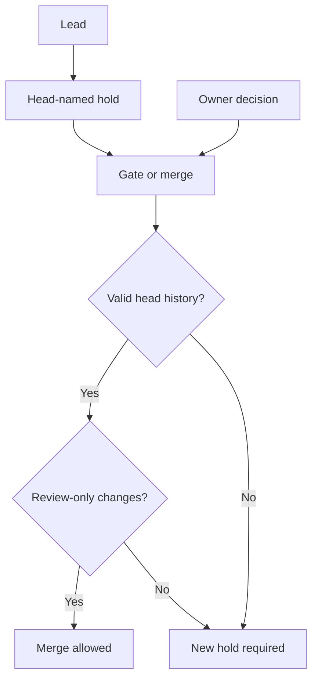

<h3>PR Summary by Qodo</h3>

Bind reason-5 merge decisions to the head named by their hold


<code>🐞 Bug fix</code> <code>🧪 Tests</code> <code>📝 Documentation</code> <code>🕐 40+ Minutes</code>


<details>
<summary>AI Description</summary>

<dl>
<dd>
<br/>

><pre>
>• Require merge holds to name the PR head shown to the decision-maker.
>• Refuse reason-5 decisions after a history rewrite or non-review change; allow review-record-only
>  commits.
>• Document the new hold workflow and test gate and merge behavior offline.
></pre>

</dd>
</dl>

</details>

<!-- qodo-describe-risk-slot --><!-- qodo-describe-risk -->
<!-- qodo-describe-risk-start:1794959815.678936005 -->

<details>
<summary>Merge Risk <code>🟡 Medium</code></summary>

<dl>
<dd>

<br/>

<details>
<summary>Blast radius <code>🟢 Low</code> <code>💥 1 capability</code></summary>

<dl>
<dd>

<br/>

- 1 affected end-to-end capability after fault-specific containment; implementation boundaries do not widen its functional scope.
- The changed hold parsing, head comparison, gate verdict, and merge preflight all implement one bounded outcome: deciding whether an owner decision authorizes merging a sensitive-path PR.
- The propagation path reaches the same gate and then the optional merge operation; these are not independent functional scopes.
- The same end-to-end sensitive-path authorization behavior covers both the gate result and the merge preflight; a merge is a consumer of the authorization, not a separate functional scope.

<details>
<summary>Sources</summary>

<dl>
<dd>

[room.py\[2560-2586\]](https://github.com/SigorMatt/agent-room/blob/d9722dd16c67573f47c9e7f8d2e9aaf5273d1576/room.py#L2560-L2586)

```python
    # the decision must answer this PR's hold: the lead's MERGE-HOLD-n (same n) for reason 5, these paths
    # and a head whose code is HEAD's but for review records, posted before it and not edited since (an
    # edit keeps the comment's id)
    n = a.decision.rsplit("-", 1)[1]
    holds = room.holds(f"MERGE-HOLD-{n}")
    lacking = [hold_problems(m["text"], a.pr, paths) for m in holds]
    whole = [h for h, problems in zip(holds, lacking) if not problems]
    moved = {h["id"]: hold_head_problem(root, h["text"], n, a.pr, head) for h in whole}
    fresh = [h for h in whole if not moved[h["id"]]]
    decisions = room.decisions(a.decision)
    pair = next(((h, d) for h in fresh for d in decisions if room.before(h, d)), None)
    if pair:
        g.ok("sensitive paths", f"{held}: allowed by {a.decision} (comment #{pair[1]['id']}), answering "
                                f"MERGE-HOLD-{n} (comment #{pair[0]['id']})")
        return
    edited = next((h for h in fresh for d in decisions if h["id"] < d["id"]), None)
    hold = fresh[0] if fresh else None
    others = [h for h in whole if moved[h["id"]]]  # a hold for other code: the one the decision answers, or the newest
    stale = next((h for h in others for d in decisions if room.before(h, d)), others[-1] if others else None)
    prefix = f"{held}; --allow-hold 5 --decision {a.decision}: "
    if edited:
        missing = f"MERGE-HOLD-{n} (comment #{edited['id']}) edited after {a.decision}: post a new hold"
    elif hold:
        missing = f"no trusted {a.decision} from the architect or Matthew after MERGE-HOLD-{n} (comment #{hold['id']})"
    elif stale:
        g.fail("sensitive paths", [(prefix + moved[stale["id"]], 5)])
        return
```

</dd>
</dl>

</details>

</dd>
</dl>

</details>
<details>
<summary>Behavioral complexity <code>🟡 Medium</code> <code>🧩 Interacting branches, Compatibility cases</code></summary>

<dl>
<dd>

<br/>

- Before: a reason-5 decision was matched to a trusted hold by PR, reason, sensitive paths, comment order and edit status, without comparing the hold&#x27;s code state.
- After: the implementation parses a head token, resolves it as a commit, checks PR ancestry, diffs the hold head to the gated head, exempts only review-record paths, separates fresh from moved holds, and reports a stale-head refusal; gate and merge must both observe the same transition.
- New correctness conditions: \(1\) old and current PR histories must be related correctly, including force-push cases; \(2\) review-record-only changes must remain allowable while any code or non-exempt path forces re-hold; \(3\) multiple holds with the same decision number must select only a current, unedited hold; and \(4\) merge must enforce exactly the same result as gate before its external effect.
- These are newly interacting compatibility and ordering conditions, not complexity inherited merely from existing parsing or Git helpers.

<details>
<summary>Sources</summary>

<dl>
<dd>

[room.py\[2560-2586\]](https://github.com/SigorMatt/agent-room/blob/d9722dd16c67573f47c9e7f8d2e9aaf5273d1576/room.py#L2560-L2586)

```python
    # the decision must answer this PR's hold: the lead's MERGE-HOLD-n (same n) for reason 5, these paths
    # and a head whose code is HEAD's but for review records, posted before it and not edited since (an
    # edit keeps the comment's id)
    n = a.decision.rsplit("-", 1)[1]
    holds = room.holds(f"MERGE-HOLD-{n}")
    lacking = [hold_problems(m["text"], a.pr, paths) for m in holds]
    whole = [h for h, problems in zip(holds, lacking) if not problems]
    moved = {h["id"]: hold_head_problem(root, h["text"], n, a.pr, head) for h in whole}
    fresh = [h for h in whole if not moved[h["id"]]]
    decisions = room.decisions(a.decision)
    pair = next(((h, d) for h in fresh for d in decisions if room.before(h, d)), None)
    if pair:
        g.ok("sensitive paths", f"{held}: allowed by {a.decision} (comment #{pair[1]['id']}), answering "
                                f"MERGE-HOLD-{n} (comment #{pair[0]['id']})")
        return
    edited = next((h for h in fresh for d in decisions if h["id"] < d["id"]), None)
    hold = fresh[0] if fresh else None
    others = [h for h in whole if moved[h["id"]]]  # a hold for other code: the one the decision answers, or the newest
    stale = next((h for h in others for d in decisions if room.before(h, d)), others[-1] if others else None)
    prefix = f"{held}; --allow-hold 5 --decision {a.decision}: "
    if edited:
        missing = f"MERGE-HOLD-{n} (comment #{edited['id']}) edited after {a.decision}: post a new hold"
    elif hold:
        missing = f"no trusted {a.decision} from the architect or Matthew after MERGE-HOLD-{n} (comment #{hold['id']})"
    elif stale:
        g.fail("sensitive paths", [(prefix + moved[stale["id"]], 5)])
        return
```

</dd>
</dl>

</details>

</dd>
</dl>

</details>
<details>
<summary>Potential damage <code>🔴 High</code> <code>🩹 Integrity</code></summary>

<dl>
<dd>

<br/>

- If the new validation incorrectly accepts a stale hold, cmd&#95;merge can proceed with a GitHub merge for code that the decision did not cover.
- The resulting merge is an external repository change and may require a deliberate revert or corrective PR plus a fresh review; reverting room.py afterward does not undo an already completed merge.
- This is a bounded integrity risk for the sensitive-path merge authorization capability, not a claim that unrelated application data is corrupted.
- Potentially recoverable only through explicit repository remediation: revert or corrective PR, review, and a new merge decision.
- Code rollback prevents recurrence but does not compensate for an already merged change.

<details>
<summary>Sources</summary>

<dl>
<dd>

[room.py\[2560-2586\]](https://github.com/SigorMatt/agent-room/blob/d9722dd16c67573f47c9e7f8d2e9aaf5273d1576/room.py#L2560-L2586)

```python
    # the decision must answer this PR's hold: the lead's MERGE-HOLD-n (same n) for reason 5, these paths
    # and a head whose code is HEAD's but for review records, posted before it and not edited since (an
    # edit keeps the comment's id)
    n = a.decision.rsplit("-", 1)[1]
    holds = room.holds(f"MERGE-HOLD-{n}")
    lacking = [hold_problems(m["text"], a.pr, paths) for m in holds]
    whole = [h for h, problems in zip(holds, lacking) if not problems]
    moved = {h["id"]: hold_head_problem(root, h["text"], n, a.pr, head) for h in whole}
    fresh = [h for h in whole if not moved[h["id"]]]
    decisions = room.decisions(a.decision)
    pair = next(((h, d) for h in fresh for d in decisions if room.before(h, d)), None)
    if pair:
        g.ok("sensitive paths", f"{held}: allowed by {a.decision} (comment #{pair[1]['id']}), answering "
                                f"MERGE-HOLD-{n} (comment #{pair[0]['id']})")
        return
    edited = next((h for h in fresh for d in decisions if h["id"] < d["id"]), None)
    hold = fresh[0] if fresh else None
    others = [h for h in whole if moved[h["id"]]]  # a hold for other code: the one the decision answers, or the newest
    stale = next((h for h in others for d in decisions if room.before(h, d)), others[-1] if others else None)
    prefix = f"{held}; --allow-hold 5 --decision {a.decision}: "
    if edited:
        missing = f"MERGE-HOLD-{n} (comment #{edited['id']}) edited after {a.decision}: post a new hold"
    elif hold:
        missing = f"no trusted {a.decision} from the architect or Matthew after MERGE-HOLD-{n} (comment #{hold['id']})"
    elif stale:
        g.fail("sensitive paths", [(prefix + moved[stale["id"]], 5)])
        return
```

</dd>
</dl>

</details>

</dd>
</dl>

</details>
<sub>Assessed commit <a href="https://github.com/SigorMatt/agent-room/commit/d9722dd16c67573f47c9e7f8d2e9aaf5273d1576">d9722dd</a></sub>


<!-- https://github.com/SigorMatt/agent-room/commit/d9722dd16c67573f47c9e7f8d2e9aaf5273d1576 -->
</dd>
</dl>
</details>
<!-- /qodo-describe-risk -->

<details>
<summary>Diagram</summary>

<dl>
<dd>

<br/>



</dd>
</dl>

</details>


<details>
<summary>High-Level Assessment</summary>

<dl>
<dd>

<br/>

>The following are alternative approaches to this PR:

<details>
<summary><b>1. Require an exact head match</b></summary>

<dl>
<dd>

- ➕ Simpler validation without an ancestry or changed-path check.
- ➖ Review-record commits, including decision bookkeeping, would require another hold and decision.

</dd>
</dl>

</details>

>**Recommendation:** Keep the ancestry-and-review-exemption approach. It prevents a decision from authorizing newly changed code while allowing the existing review-record workflow to advance the PR head.

</dd>
</dl>

</details>

<details>
<summary> Files changed (13) <code> +408 / -36 </code> </summary>

<dl>
<dd>

<br/>

<details>
<summary>Bug fix (1) <code> +47 / -10 </code></summary>

<dl>
<dd>

<details>
<summary>room.py<code>Validate a hold&#x27;s named head before allowing reason 5</code> <code>+47/-10</code></summary>

<br/>

>Validate a hold&#x27;s named head before allowing reason 5
>
><pre>
>• Requires a head token, verifies that it resolves to an ancestor of the gated head, and rejects intervening non-review changes. Adds the checked head to failure verdicts and gives leads a current-head re-hold instruction.
></pre>
>
><a href='https://github.com/SigorMatt/agent-room/pull/16/files#diff-36e706accba1fe5812fd1526e9931f792f8e314ada3f00e0e24e85cd44fb2433'>room.py</a>

</details>

</dd>
</dl>

</details>

<details>
<summary>Tests (2) <code> +298 / -19 </code></summary>

<dl>
<dd>

<details>
<summary>test_gate.py<code>Adapt the gate harness to head-bearing holds</code> <code>+28/-19</code></summary>

<br/>

>Adapt the gate harness to head-bearing holds
>
><pre>
>• Updates existing hold fixtures and form assertions, checks the head suffix on failure verdicts, and makes the harness importable by the M6f suite.
></pre>
>
><a href='https://github.com/SigorMatt/agent-room/pull/16/files#diff-0455534b2c2add6c0a8083936017b43479084ebab176ca42600af732479450f9'>tests/test_gate.py</a>

</details>

<details>
<summary>test_m6f.py<code>Test head-bound decisions through gate and merge</code> <code>+270/-0</code></summary>

<br/>

>Test head-bound decisions through gate and merge
>
><pre>
>• Adds offline coverage for head parsing, review-only advances, changed code, rewritten or unresolved heads, missing heads, repeated or edited holds, failure verdicts, and merge behavior.
></pre>
>
><a href='https://github.com/SigorMatt/agent-room/pull/16/files#diff-a1021ad1eb330d28a1a93767c9bb59ed5b88d57c79f4353ff7cc1038d400f486'>tests/test_m6f.py</a>

</details>

</dd>
</dl>

</details>

<details>
<summary>Documentation (10) <code> +63 / -7 </code></summary>

<dl>
<dd>

<details>
<summary>ARCHITECT.md<code>Explain how to resolve multiple open holds</code> <code>+2/-0</code></summary>

<br/>

>Explain how to resolve multiple open holds
>
><pre>
>• Directs the architect to answer the newest hold, show changes on held paths since an older hold, and clear older holds without authorizing a merge.
></pre>
>
><a href='https://github.com/SigorMatt/agent-room/pull/16/files#diff-ea2e7d73022c92135dc25cc66e267892824f32ecb823bb758697588c630d9cc1'>ARCHITECT.md</a>

</details>

<details>
<summary>CHANGELOG.md<code>Record head-bound merge holds</code> <code>+1/-0</code></summary>

<br/>

>Record head-bound merge holds
>
><pre>
>• Describes the new hold format, gate refusals, and procedure for multiple open holds.
></pre>
>
><a href='https://github.com/SigorMatt/agent-room/pull/16/files#diff-06572a96a58dc510037d5efa622f9bec8519bc1beab13c9f251e97e657a9d4ed'>CHANGELOG.md</a>

</details>

<details>
<summary>LEAD.md<code>Require the checked head in each hold</code> <code>+2/-2</code></summary>

<br/>

>Require the checked head in each hold
>
><pre>
>• Instructs leads to append the head from the gate&#x27;s failure verdict, or from the merge SHA when GitHub reports the PR unmergeable.
></pre>
>
><a href='https://github.com/SigorMatt/agent-room/pull/16/files#diff-0d7d95c154bdf0eaee1f65e13b353b2c0c4950ddce9c78849fbf72025b313c79'>LEAD.md</a>

</details>

<details>
<summary>BUILD-STATE.md<code>Track M6f and mark B-11 done</code> <code>+2/-1</code></summary>

<br/>

>Track M6f and mark B-11 done
>
><pre>
>• Adds an M6f milestone row marked in progress and records B-11 as done in M6f.
></pre>
>
><a href='https://github.com/SigorMatt/agent-room/pull/16/files#diff-eb974eadcb2e1d4f382c2409c07a470b3df0574298ed8eda187eb1a6d7b1375f'>docs/design/BUILD-STATE.md</a>

</details>

<details>
<summary>m6f-hold-head.md<code>Specify head-bound hold decisions</code> <code>+49/-0</code></summary>

<br/>

>Specify head-bound hold decisions
>
><pre>
>• Defines the head-token format, ancestry and review-record rules, refusal messages, documentation changes, and required test scenarios.
></pre>
>
><a href='https://github.com/SigorMatt/agent-room/pull/16/files#diff-2842b44330ad8c89a40c27be4e4ad914a9d62816508826f505d01c881e3d2161'>docs/design/m6f-hold-head.md</a>

</details>

<details>
<summary>answer-a-buzz.md<code>Explain which code a hold decision covers</code> <code>+1/-1</code></summary>

<br/>

>Explain which code a hold decision covers
>
><pre>
>• Tells Matthew that a hold names the code shown and that, when several holds are open, the architect presents changes before the newest is answered.
></pre>
>
><a href='https://github.com/SigorMatt/agent-room/pull/16/files#diff-d3a70a640b14f1436419811a13d5e127a067c49ce42446d9f02bf5cbe82b2419'>docs/manual/answer-a-buzz.md</a>

</details>

<details>
<summary>glossary.md<code>Define a merge hold&#x27;s head</code> <code>+1/-1</code></summary>

<br/>

>Define a merge hold&#x27;s head
>
><pre>
>• Clarifies that a merge hold names the head shown to Matthew and limits what its decision covers.
></pre>
>
><a href='https://github.com/SigorMatt/agent-room/pull/16/files#diff-ab49e26773cd11b72502ca499f805f8e87462242295c83306982316c497a2c7f'>docs/manual/glossary.md</a>

</details>

<details>
<summary>merge-hold-list.md<code>Show the new merge-hold message form</code> <code>+1/-1</code></summary>

<br/>

>Show the new merge-hold message form
>
><pre>
>• Adds the head token to the example hold required by the checklist.
></pre>
>
><a href='https://github.com/SigorMatt/agent-room/pull/16/files#diff-685946f8f4f43d705ba6cc5573fb8ecbec47aef546962109c86f4f6df839c880'>docs/manual/merge-hold-list.md</a>

</details>

<details>
<summary>message-kinds.md<code>Include the head in the hold message reference</code> <code>+1/-1</code></summary>

<br/>

>Include the head in the hold message reference
>
><pre>
>• Updates the MERGE-HOLD entry to show that the message includes the head presented for a decision.
></pre>
>
><a href='https://github.com/SigorMatt/agent-room/pull/16/files#diff-09cb0a2e151eb8b9ccf8fcf259fac66b6f8b7bac0b9ac7fbf08a92c6668fd328'>docs/manual/message-kinds.md</a>

</details>

<details>
<summary>troubleshooting.md<code>Explain three head-related gate refusals</code> <code>+3/-0</code></summary>

<br/>

>Explain three head-related gate refusals
>
><pre>
>• Adds guidance for a head outside the PR&#x27;s history, code changed since the hold, and a hold missing its head.
></pre>
>
><a href='https://github.com/SigorMatt/agent-room/pull/16/files#diff-bfec8ea3d3009f9d7d15f1153d8a9db48d7c0e60aa0343ad065af35765dbc2e4'>docs/manual/troubleshooting.md</a>

</details>

</dd>
</dl>

</details>

</dd>
</dl>

</details>

<!-- qodo-describe-head:d9722dd16c67573f47c9e7f8d2e9aaf5273d1576 -->