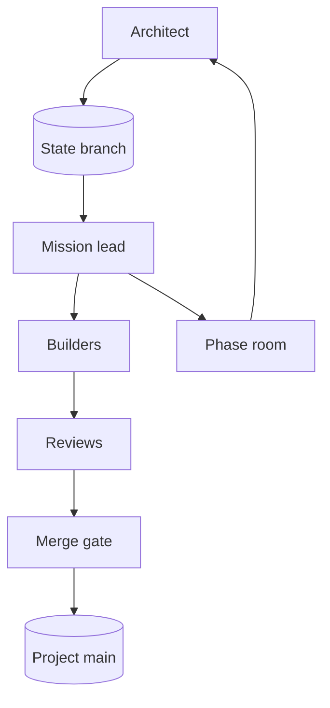

<h3>PR Summary by Qodo</h3>

Document the approved v1 pipeline design and build state

<code>📝 Documentation</code> <code>⚙️ Configuration changes</code> <code>🕐 20-40 Minutes</code>

AI Description

<dl>
<dd>
 

><pre>
>• Establish the approved v1 design as the source of truth for the pipeline build.
>• Record milestones, platform-check results, and pre-approved fallbacks so future sessions can
>  resume.
>• Ignore local worktrees and Python cache files.
></pre>

</dd>
</dl>

Diagram

<dl>
<dd>

 

</dd>
</dl>

High-Level Assessment

<dl>
<dd>

 

>Keeping the approved design and resumable build state in separate versioned documents is appropriate: one defines the intended protocol, while the other records findings that may change its implementation. Before building from them, reconcile the design&#x27;s statements that builders push task branches with BUILD-STATE.md&#x27;s later decision that builders never push.

</dd>
</dl>

 Files changed (3) <code> +465 / -0 </code> 

<dl>
<dd>

 

Documentation (2) <code> +463 / -0 </code>

<dl>
<dd>

BUILD-STATE.md<code>Record milestones, platform checks, and build decisions</code> <code>+66/-0</code>

 

>Record milestones, platform checks, and build decisions
>
><pre>
>• Adds a session-resumption record with milestone status, pre-approved fallbacks, and results or pending probes for eleven platform assumptions. Documents findings about branch deletion, private-repository protection, and empty repositories, including the decision to keep builder branches local.
></pre>
>
><a href='https://github.com/SigorMatt/agent-room/pull/5/files#diff-eb974eadcb2e1d4f382c2409c07a470b3df0574298ed8eda187eb1a6d7b1375f'>docs/design/BUILD-STATE.md</a>

v1.md<code>Establish the approved v1 pipeline design</code> <code>+397/-0</code>

 

>Establish the approved v1 pipeline design
>
><pre>
>• Defines roles, state ownership, mission lifecycle, reviews, merge safeguards, lead rotation, security boundaries, and release procedures. Also specifies platform assumptions, failure drills, and the planned build sequence.
></pre>
>
><a href='https://github.com/SigorMatt/agent-room/pull/5/files#diff-2b52e99c393c109f0060898a48e99b807bac479fa6f867b8e9b985ed76357204'>docs/design/v1.md</a>

</dd>
</dl>

Other (1) <code> +2 / -0 </code>

<dl>
<dd>

.gitignore<code>Ignore local worktrees and Python caches</code> <code>+2/-0</code>

 

>Ignore local worktrees and Python caches
>
><pre>
>• Excludes Claude worktrees and Python cache directories from version control.
></pre>
>
><a href='https://github.com/SigorMatt/agent-room/pull/5/files#diff-bc37d034bad564583790a46f19d807abfe519c5671395fd494d8cce506c42947'>.gitignore</a>

</dd>
</dl>

</dd>
</dl>

