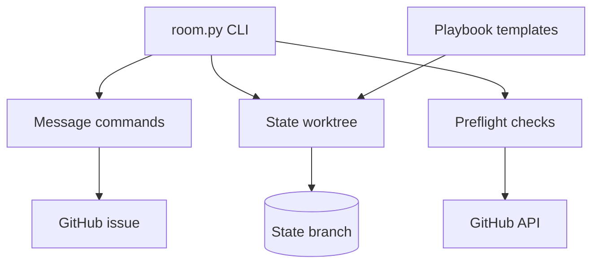

<h3>PR Summary by Qodo</h3>

Add session-aware room messaging, state leases, and preflight checks

<!-- qodo-describe-risk-badge -->
<!-- /qodo-describe-risk-badge -->
<code>✨ Enhancement</code> <code>🧪 Tests</code> <code>📝 Documentation</code> <code>🕐 40+ Minutes</code>

<!-- qodo-describe-risk-slot -->

AI Description

<dl>
<dd>
 

><pre>
>• Adds session-aware messaging, role guards, cursor handover, and automatic escalation
>  notifications.
></pre>

</dd>
</dl>

Diagram

<dl>
<dd>

 

</dd>
</dl>

High-Level Assessment

<dl>
<dd>

 

>The following are alternative approaches to this PR:

<b>1. Split state and messaging into modules</b>

<dl>
<dd>

- ➕ Separates Git lease logic from issue messaging as the CLI grows.
- ➕ Allows narrower tests and ownership boundaries.
- ➖ Complicates the specified standalone, single-file distribution.
- ➖ Adds packaging work without changing the v1 coordination model.

</dd>
</dl>

>**Recommendation:** Keep the single-file CLI for v1 because standalone distribution is an explicit constraint. Consider extracting state and lease logic if later milestones make the file materially harder to maintain. Review the documented M4 deferrals separately: hand-damaged machine blocks and stale worktree recovery remain known edge cases.

</dd>
</dl>

 Files changed (21) <code> +3425 / -91 </code> 

<dl>
<dd>

 

Enhancement (7) <code> +1322 / -55 </code>

<dl>
<dd>

room.py<code>Implement messaging, Git-backed state leases, and preflight</code> <code>+1174/-55</code>

 

>Implement messaging, Git-backed state leases, and preflight
>
><pre>
>• Adds session-aware message filtering, cursor handover, kind-based role guards, and automatic, secret-scrubbed notifications. Introduces state-worktree commands and history-backed lease checks with push-race handling, plus repository and environment preflight checks.
></pre>
>
><a href='https://github.com/SigorMatt/agent-room/pull/6/files#diff-36e706accba1fe5812fd1526e9931f792f8e314ada3f00e0e24e85cd44fb2433'>room.py</a>

DESIGN.md<code>Provide an architect-owned design template</code> <code>+32/-0</code>

 

>Provide an architect-owned design template
>
><pre>
>• Adds prompts for goals, architecture, interfaces, data, and decisions when a state branch is initialized.
></pre>
>
><a href='https://github.com/SigorMatt/agent-room/pull/6/files#diff-1837fc20ba5caecfb51ed9ebc6e98b75d157decf50bd7cdc969469cf716005d1'>templates/playbook/DESIGN.md</a>

HANDOFF.md<code>Provide an architect handoff template</code> <code>+18/-0</code>

 

>Provide an architect handoff template
>
><pre>
>• Adds a short format for the latest design-session note, open threads, and owner preferences.
></pre>
>
><a href='https://github.com/SigorMatt/agent-room/pull/6/files#diff-7c7e6273077e424097c40398806ebcb89ac4c724be2d706b778a5cf35b14461b'>templates/playbook/HANDOFF.md</a>

LEDGER.md<code>Provide a deferred-findings ledger template</code> <code>+6/-0</code>

 

>Provide a deferred-findings ledger template
>
><pre>
>• Adds the lead-owned table used to track deferred review findings and their targets.
></pre>
>
><a href='https://github.com/SigorMatt/agent-room/pull/6/files#diff-e48da22fe6aa320be98fc2f2ae9b36f45e18f886aac4ba2f9b816acac053e038'>templates/playbook/LEDGER.md</a>

MISSIONS.md<code>Provide the lead&#x27;s machine-state template</code> <code>+38/-0</code>

 

>Provide the lead&#x27;s machine-state template
>
><pre>
>• Adds the fenced state block containing the lease, mission step, cursor, counter, and intent, alongside human-readable mission tracking.
></pre>
>
><a href='https://github.com/SigorMatt/agent-room/pull/6/files#diff-eafd0e6c12d28932ad5c6e34ca73a6e6ade64cc158bcabc6537cbf9567800941'>templates/playbook/MISSIONS.md</a>

PLAYBOOK.md<code>Provide the project playbook template</code> <code>+44/-0</code>

 

>Provide the project playbook template
>
><pre>
>• Adds pipeline and repository fields, acceptance-criteria prompts, environment needs, and a merge-hold list for state initialization.
></pre>
>
><a href='https://github.com/SigorMatt/agent-room/pull/6/files#diff-2f9618754fe5519d3a54cca83efd0b37f9f8df4e7a9e806cf1c13a2b3255a5e1'>templates/playbook/PLAYBOOK.md</a>

QODO-VALUE.md<code>Provide a Qodo-value tracking template</code> <code>+10/-0</code>

 

>Provide a Qodo-value tracking template
>
><pre>
>• Adds a lead-owned format for recording each mission PR&#x27;s review findings and comparison with the cold review.
></pre>
>
><a href='https://github.com/SigorMatt/agent-room/pull/6/files#diff-ba77b470974c7be6a89bfd6f7bb16c12f7b63e3f6fa4a8eda7b4cd8e95871647'>templates/playbook/QODO-VALUE.md</a>

</dd>
</dl>

Tests (4) <code> +1466 / -29 </code>

<dl>
<dd>

fake_gh.py<code>Support concurrent reads and comment lookup in fake GitHub</code> <code>+14/-3</code>

 

>Support concurrent reads and comment lookup in fake GitHub
>
><pre>
>• Makes database writes atomic, retains issue bodies, and supports fetching an individual comment for cursor handover tests.
></pre>
>
><a href='https://github.com/SigorMatt/agent-room/pull/6/files#diff-7c666a3b82b131a6a539c5a71caa5902d487d149c75baee27bd9834f43220b47'>tests/fake_gh.py</a>

fake_gh_state.py<code>Add configurable fake GitHub repository settings</code> <code>+49/-0</code>

 

>Add configurable fake GitHub repository settings
>
><pre>
>• Supplies repository, branch-protection, rule, and ruleset responses for preflight tests, delegating other calls to the existing fake.
></pre>
>
><a href='https://github.com/SigorMatt/agent-room/pull/6/files#diff-6aa9adf56b470d1fdf237fccce1390505d2787d7e6e5509589e0704ad4e3e54a'>tests/fake_gh_state.py</a>

test_room.py<code>Exercise session-aware room behavior</code> <code>+363/-26</code>

 

>Exercise session-aware room behavior
>
><pre>
>• Adds tests for session filtering, trusted cursor recovery, message kinds and role guards, notifications, closing, and version-pinned links. Adjusts existing message tests to use posting roles.
></pre>
>
><a href='https://github.com/SigorMatt/agent-room/pull/6/files#diff-06a017b0874187b6527945969d72c69b697b9b5884c50da1ef33dfb26f84ee5b'>tests/test_room.py</a>

test_state.py<code>Exercise state, lease, and preflight against local remotes</code> <code>+1040/-0</code>

 

>Exercise state, lease, and preflight against local remotes
>
><pre>
>• Uses bare Git repositories and fake GitHub responses to cover initialization, lease ownership, push races, damaged blocks, stale worktrees, and single-branch checkouts. Also tests preflight outcomes and standalone template downloads.
></pre>
>
><a href='https://github.com/SigorMatt/agent-room/pull/6/files#diff-5afca8e5f21c0b4ea0fdce909beeaf1b42de838e9f0543652d8584d71e1fcf7e'>tests/test_state.py</a>

</dd>
</dl>

Documentation (10) <code> +637 / -7 </code>

<dl>
<dd>

BUILD-STATE.md<code>Record platform findings and lease decisions</code> <code>+30/-7</code>

 

>Record platform findings and lease decisions
>
><pre>
>• Updates milestone status and platform-check results, including scheduled-session and idle-container behavior. Records lease handover decisions, assumptions made during the build, and the stale-worktree and block-parsing cases deferred to M4.
></pre>
>
><a href='https://github.com/SigorMatt/agent-room/pull/6/files#diff-eb974eadcb2e1d4f382c2409c07a470b3df0574298ed8eda187eb1a6d7b1375f'>docs/design/BUILD-STATE.md</a>

m2-room-cli.md<code>Specify the M2 room CLI</code> <code>+105/-0</code>

 

>Specify the M2 room CLI
>
><pre>
>• Defines session-aware messages, command behavior, state-branch operations, lease rules, preflight checks, and required tests. Incorporates decisions from the M2 cold reviews.
></pre>
>
><a href='https://github.com/SigorMatt/agent-room/pull/6/files#diff-a779f6533f0f989466ad101820c3c98cbb42255104ac9869dc0fa4df9fa927aa'>docs/design/m2-room-cli.md</a>

m3-reviews-gate.md<code>Draft review-gate and merge specifications</code> <code>+130/-0</code>

 

>Draft review-gate and merge specifications
>
><pre>
>• Specifies review-record formats, coverage and disposition checks, merge holds, and the proposed gate and merge commands for the next milestone.
></pre>
>
><a href='https://github.com/SigorMatt/agent-room/pull/6/files#diff-1d80bc747f61196b20f463418d4f5a8ed63e17504c309ba79834aa3278ce332f'>docs/design/m3-reviews-gate.md</a>

m4-unattended.md<code>Draft unattended-operation specification</code> <code>+53/-0</code>

 

>Draft unattended-operation specification
>
><pre>
>• Outlines future watchdog, handoff, reconciliation, budget, and lifecycle helpers. These commands are specified here, not implemented in this PR.
></pre>
>
><a href='https://github.com/SigorMatt/agent-room/pull/6/files#diff-186aba1044a5bc77eb91205ab98e4ae0b8d5afb7d33aa2d67bc9568ede78f151'>docs/design/m4-unattended.md</a>

DISPOSITIONS.md<code>Track dispositions for M2 review findings</code> <code>+35/-0</code>

 

>Track dispositions for M2 review findings
>
><pre>
>• Records fixes and evidence for the cold-review findings and identifies six stale-worktree and damaged-block cases deferred to M4.
></pre>
>
><a href='https://github.com/SigorMatt/agent-room/pull/6/files#diff-0c7883471e978108dbac3fee8a8d4219fbdbd66583ff07be874ac8967a8e0781'>reviews/cold/M2/DISPOSITIONS.md</a>

round-1.md<code>Document initial M2 cold review</code> <code>+97/-0</code>

 

>Document initial M2 cold review
>
><pre>
>• Records 15 findings against the initial implementation, including lease-free writes and misclassified push races. Assesses specification coverage and test gaps.
></pre>
>
><a href='https://github.com/SigorMatt/agent-room/pull/6/files#diff-3047214ede5454b84536e5b32fc5c7d57151dc7eea2b6718be58d4735241143a'>reviews/cold/M2/round-1.md</a>

round-2.md<code>Document second M2 cold review</code> <code>+109/-0</code>

 

>Document second M2 cold review
>
><pre>
>• Checks round-one fixes and records remaining issues involving renamed files, damaged state, stale worktrees, and lease-take races.
></pre>
>
><a href='https://github.com/SigorMatt/agent-room/pull/6/files#diff-a7f2e476a41b94070334f6e52288cf49259207fd49ed5e6b145de57fed30563e'>reviews/cold/M2/round-2.md</a>

scoped-1.md<code>Review stale-worktree and unreadable-lease fixes</code> <code>+29/-0</code>

 

>Review stale-worktree and unreadable-lease fixes
>
><pre>
>• Tests the round-two fixes and records cases where unreadable leases admit stale writers or stale worktree recovery affects local work.
></pre>
>
><a href='https://github.com/SigorMatt/agent-room/pull/6/files#diff-a64a1aeda68856956626e31ad59d36da08c83e347c78712202a74a2fc9477e85'>reviews/cold/M2/scoped-1.md</a>

scoped-2.md<code>Review lease interpretation under block damage</code> <code>+24/-0</code>

 

>Review lease interpretation under block damage
>
><pre>
>• Documents how quoted lease lines, missing holders, and damaged blocks could defeat the intended lease guard. Checks the preceding scoped fixes.
></pre>
>
><a href='https://github.com/SigorMatt/agent-room/pull/6/files#diff-8adc7c71d695d326873ba043a2ba1b1ae8523d2cabe69b171fb34db750121e1d'>reviews/cold/M2/scoped-2.md</a>

scoped-3.md<code>Record remaining machine-block parsing risks</code> <code>+25/-0</code>

 

>Record remaining machine-block parsing risks
>
><pre>
>• Verifies history-based lease recovery and commit protections. Identifies three hand-edit damage cases deferred for stricter parsing in M4.
></pre>
>
><a href='https://github.com/SigorMatt/agent-room/pull/6/files#diff-70b58319a6e5a50b717cad4007553bc39c73d0cf41bf390c6f8d07b04a31c696'>reviews/cold/M2/scoped-3.md</a>

</dd>
</dl>

</dd>
</dl>

<!-- qodo-describe-head:870f10beea0d145859842b5a254b52c98d2cfb39 -->