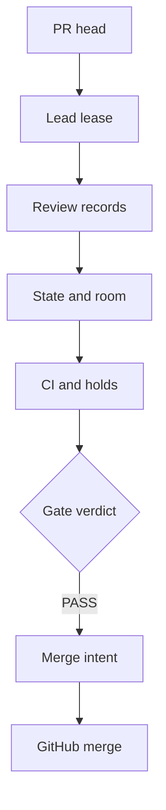

<h3>PR Summary by Qodo</h3>

Add review-record validation, merge gate, and guarded merge command

<!-- qodo-describe-risk-badge -->
<!-- /qodo-describe-risk-badge -->
<code>✨ Enhancement</code> <code>🧪 Tests</code> <code>📝 Documentation</code> <code>⚙️ Configuration changes</code> <code>🕐 40+ Minutes</code>

<!-- qodo-describe-risk-slot -->

AI Description

<dl>
<dd>
 

><pre>
>• Add review records and a gate that checks coverage, dispositions, CI, and sensitive paths.
>• Require a passing gate and checked head SHA before recording merge intent and merging.
>• Expand merge-hold defaults and test review parsing, gate verdicts, and merge failures.
></pre>

</dd>
</dl>

Diagram

<dl>
<dd>

 

</dd>
</dl>

High-Level Assessment

<dl>
<dd>

 

>The following are alternative approaches to this PR:

<b>1. Rely on GitHub branch protection for CI</b>

<dl>
<dd>

- ➕ Reduces custom check-status handling and maintenance.
- ➖ Does not enforce cold or Qodo dispositions, review coverage, ledger entries, or room decisions.
- ➖ Required protections may be unavailable for some repositories.

</dd>
</dl>

>**Recommendation:** Keep the integrated gate because the review and owner-decision rules extend beyond GitHub&#x27;s native protections. Use branch protection as an additional safeguard where available, not a replacement for the SHA-bound gate.

</dd>
</dl>

 Files changed (16) <code> +2897 / -19 </code> 

<dl>
<dd>

 

Enhancement (1) <code> +1033 / -0 </code>

<dl>
<dd>

room.py<code>Implement review parsing, merge gate, and guarded merge</code> <code>+1033/-0</code>

 

>Implement review parsing, merge gate, and guarded merge
>
><pre>
>• Adds gate checks for the PR and lease, review coverage, cold and Qodo dispositions, ledger deferrals, trusted room decisions, HEAD checks, and playbook merge-hold patterns. Adds PASS/WAIT/FAIL verdicts and a merge command that records intent, names the checked SHA, and reports reconciliation needs after state-update failures.
></pre>
>
><a href='https://github.com/SigorMatt/agent-room/pull/7/files#diff-36e706accba1fe5812fd1526e9931f792f8e314ada3f00e0e24e85cd44fb2433'>room.py</a>

</dd>
</dl>

Tests (3) <code> +1531 / -1 </code>

<dl>
<dd>

fake_gh_state.py<code>Simulate PR, check, status, and merge API responses</code> <code>+38/-1</code>

 

>Simulate PR, check, status, and merge API responses
>
><pre>
>• Extends the GitHub API stand-in with paginated check data and SHA-aware merge responses. Logs merge requests so tests can verify their payloads.
></pre>
>
><a href='https://github.com/SigorMatt/agent-room/pull/7/files#diff-6aa9adf56b470d1fdf237fccce1390505d2787d7e6e5509589e0704ad4e3e54a'>tests/fake_gh_state.py</a>

test_gate.py<code>Exercise gate policy and merge outcomes end to end</code> <code>+1459/-0</code>

 

>Exercise gate policy and merge outcomes end to end
>
><pre>
>• Builds local mission and state branches with fake GitHub responses to test parsing, coverage, dispositions, CI timing, sensitive holds, and merge exit paths. Includes regressions for the recorded cold-review findings.
></pre>
>
><a href='https://github.com/SigorMatt/agent-room/pull/7/files#diff-0455534b2c2add6c0a8083936017b43479084ebab176ca42600af732479450f9'>tests/test_gate.py</a>

test_qodo_doc.py<code>Protect embedded Qodo tool appendix</code> <code>+34/-0</code>

 

>Protect embedded Qodo tool appendix
>
><pre>
>• Extracts and compiles the documented tool, then compares its hash with the appendix on origin/main when that reference is available.
></pre>
>
><a href='https://github.com/SigorMatt/agent-room/pull/7/files#diff-3e258f235d699cfeb10473247d02619fc7a03a3a422e85c3aa84e39d36d99ade'>tests/test_qodo_doc.py</a>

</dd>
</dl>

Documentation (11) <code> +321 / -13 </code>

<dl>
<dd>

QODO-REVIEW.md<code>Document agent-room deviations from the Qodo method</code> <code>+11/-0</code>

 

>Document agent-room deviations from the Qodo method
>
><pre>
>• Adds four agent-room-specific differences covering merge ownership, disposition fields, missing first reviews, and reporting destinations. Points readers to the review-record formats without changing the embedded tool appendix.
></pre>
>
><a href='https://github.com/SigorMatt/agent-room/pull/7/files#diff-c0987ac34aeadae12aa48f8553f2a04a8187dac8f652a9f55b9338e14cf642c6'>docs/QODO-REVIEW.md</a>

BUILD-STATE.md<code>Advance milestone status and clarify B-4 ownership</code> <code>+3/-3</code>

 

>Advance milestone status and clarify B-4 ownership
>
><pre>
>• Marks M2 done and M3 in review. Notes that the weakened-tests hold is specified in M3 while its lead-protocol guidance remains for M5.
></pre>
>
><a href='https://github.com/SigorMatt/agent-room/pull/7/files#diff-eb974eadcb2e1d4f382c2409c07a470b3df0574298ed8eda187eb1a6d7b1375f'>docs/design/BUILD-STATE.md</a>

m3-reviews-gate.md<code>Specify refined gate and merge rules</code> <code>+63/-10</code>

 

>Specify refined gate and merge rules
>
><pre>
>• Clarifies Qodo archive completeness, disposition and ledger checks, trusted room decisions, CI waiting periods, and sensitive-path holds. Documents the cold-review findings and resulting behavioral changes.
></pre>
>
><a href='https://github.com/SigorMatt/agent-room/pull/7/files#diff-1d80bc747f61196b20f463418d4f5a8ed63e17504c309ba79834aa3278ce332f'>docs/design/m3-reviews-gate.md</a>

DISPOSITIONS.md<code>Record dispositions for M3 cold findings</code> <code>+39/-0</code>

 

>Record dispositions for M3 cold findings
>
><pre>
>• Accounts for findings across both rounds and the scoped review, with fix commits or dismissal reasons and evidence.
></pre>
>
><a href='https://github.com/SigorMatt/agent-room/pull/7/files#diff-4ebd9dec59d97303a81e3ba11712bc254acdc6c921007cccb4b8022c07978c90'>reviews/cold/M3/DISPOSITIONS.md</a>

round-1.md<code>Archive the first M3 cold review</code> <code>+57/-0</code>

 

>Archive the first M3 cold review
>
><pre>
>• Records the reviewed commit, 17 findings, acceptance-criteria assessment, and scope observations for the initial gate implementation.
></pre>
>
><a href='https://github.com/SigorMatt/agent-room/pull/7/files#diff-091dc33c15d00066ee51d8d5819f07d6364c08e7379e869becc3607dcf4a330d'>reviews/cold/M3/round-1.md</a>

round-2.md<code>Archive the second M3 cold review</code> <code>+55/-0</code>

 

>Archive the second M3 cold review
>
><pre>
>• Records 12 additional findings concerning decisions, archives, CI timing, globs, and deferrals. Assesses the first round of fixes.
></pre>
>
><a href='https://github.com/SigorMatt/agent-room/pull/7/files#diff-9d2684f8d48f79a5953e14945710c8bfb7f207cf8a617e7314ce2138087706ce'>reviews/cold/M3/round-2.md</a>

scoped-1.md<code>Archive the scoped review of round-two fixes</code> <code>+37/-0</code>

 

>Archive the scoped review of round-two fixes
>
><pre>
>• Records six follow-up findings and evaluates the second round of corrections, including sensitive-path matching and room-message references.
></pre>
>
><a href='https://github.com/SigorMatt/agent-room/pull/7/files#diff-03de3d934c4828c3ed1c92a53be25d9b96934867a1b5144c949f1cee81d8d16f'>reviews/cold/M3/scoped-1.md</a>

cold-DISPOSITIONS.md<code>Add cold-disposition table template</code> <code>+4/-0</code>

 

>Add cold-disposition table template
>
><pre>
>• Provides the finding ID, severity, file, disposition, and evidence columns expected for cold-review decisions.
></pre>
>
><a href='https://github.com/SigorMatt/agent-room/pull/7/files#diff-98a054cd429bb84dfdb068da66fde6f0971366693570d24963a63b7db407ee52'>templates/reviews/cold-DISPOSITIONS.md</a>

cold-round.md<code>Add cold-review round template</code> <code>+21/-0</code>

 

>Add cold-review round template
>
><pre>
>• Defines reviewed-commit metadata and sections for findings, criteria, and scope.
></pre>
>
><a href='https://github.com/SigorMatt/agent-room/pull/7/files#diff-a119d85971fb56505260e3a3be1624317d168c7e6c737c217c2c2e73408a299e'>templates/reviews/cold-round.md</a>

cold-scoped.md<code>Add scoped cold-review template</code> <code>+22/-0</code>

 

>Add scoped cold-review template
>
><pre>
>• Provides the round-review structure with an additional since-commit field for follow-up review coverage.
></pre>
>
><a href='https://github.com/SigorMatt/agent-room/pull/7/files#diff-6428da181ff82ae7a225bfddd5fca8ce3d8fe6a787f70ce64b6332a49ff654a7'>templates/reviews/cold-scoped.md</a>

qodo-DISPOSITIONS.md<code>Add Qodo-disposition record template</code> <code>+9/-0</code>

 

>Add Qodo-disposition record template
>
><pre>
>• Defines Qodo mode and archive metadata alongside finding dispositions, current Qodo status, and the cold-caught column.
></pre>
>
><a href='https://github.com/SigorMatt/agent-room/pull/7/files#diff-9c9b2009b6e854d6622408464ff4ed393f41197c2954910c28eb08a6be4b72f2'>templates/reviews/qodo-DISPOSITIONS.md</a>

</dd>
</dl>

Other (1) <code> +12 / -5 </code>

<dl>
<dd>

PLAYBOOK.md<code>Broaden default sensitive-path merge holds</code> <code>+12/-5</code>

 

>Broaden default sensitive-path merge holds
>
><pre>
>• Expands patterns for authentication, secrets, dependency manifests, migrations, and deleted tests across common nested layouts. Explains case-insensitive matching and asks the architect to tailor the deliberately broad defaults.
></pre>
>
><a href='https://github.com/SigorMatt/agent-room/pull/7/files#diff-2f9618754fe5519d3a54cca83efd0b37f9f8df4e7a9e806cf1c13a2b3255a5e1'>templates/playbook/PLAYBOOK.md</a>

</dd>
</dl>

</dd>
</dl>

<!-- qodo-describe-head:624dfffd335be6e2d94b08ff39d8af1b196b6350 -->