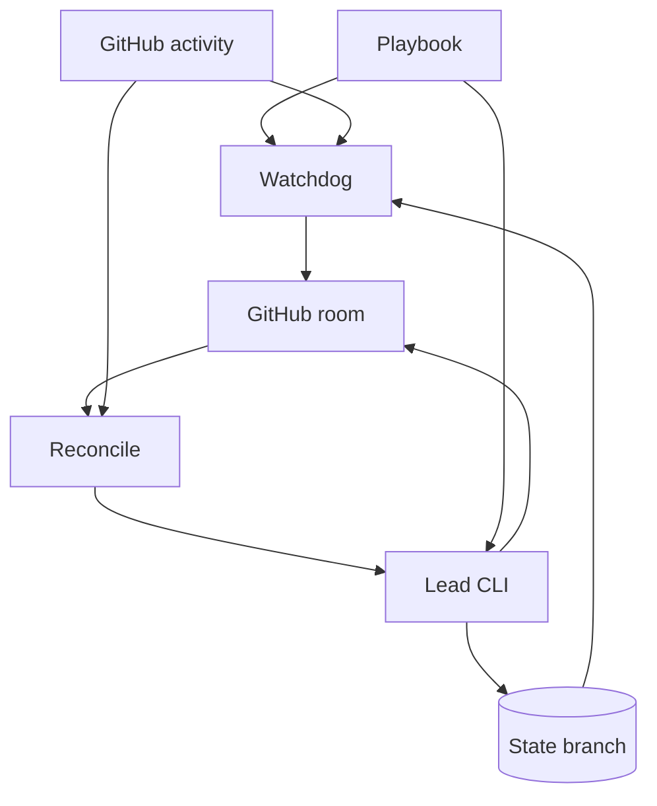

<h3>PR Summary by Qodo</h3>

Add unattended lead monitoring, handoff, reconciliation, and budgets

<!-- qodo-describe-risk-badge -->
<!-- /qodo-describe-risk-badge -->
<code>✨ Enhancement</code> <code>🐞 Bug fix</code> <code>🧪 Tests</code> <code>📝 Documentation</code> <code>🕐 40+ Minutes</code>

<!-- qodo-describe-risk-slot -->

AI Description

<dl>
<dd>
 

><pre>
>• Detect stalled leads without treating handoffs or routine state writes as progress.
></pre>

</dd>
</dl>

Diagram

<dl>
<dd>

 

</dd>
</dl>

High-Level Assessment

<dl>
<dd>

 

>The following are alternative approaches to this PR:

<b>1. Webhook-driven monitoring</b>

<dl>
<dd>

- ➕ Could detect progress and stalls more promptly without repeatedly querying GitHub.
- ➖ Requires a persistent receiver, event storage, deployment, and failure recovery outside the existing scheduled-task model.

</dd>
</dl>

>**Recommendation:** Keep the scheduled, read-only watchdog: it fits the existing GitHub-backed state and task model without adding a service. Review its progress and alarm rules carefully because those determine whether unattended failures reach the owner.

</dd>
</dl>

 Files changed (15) <code> +2274 / -55 </code> 

<dl>
<dd>

 

Enhancement (2) <code> +728 / -22 </code>

<dl>
<dd>

room.py<code>Implement unattended monitoring and lead-continuity commands</code> <code>+725/-21</code>

 

>Implement unattended monitoring and lead-continuity commands
>
><pre>
>• Adds watchdog, join-line, handoff, intent, reconcile, and budget commands, plus status and mission-start validation. Refines lease resets, room selection, trust, and stale linked-worktree recovery.
></pre>
>
><a href='https://github.com/SigorMatt/agent-room/pull/8/files#diff-36e706accba1fe5812fd1526e9931f792f8e314ada3f00e0e24e85cd44fb2433'>room.py</a>

MISSIONS.md<code>Add mission lifecycle fields to the state template</code> <code>+3/-1</code>

 

>Add mission lifecycle fields to the state template
>
><pre>
>• Adds status and mission_started to the machine block and documents their meaning and handoff ownership.
></pre>
>
><a href='https://github.com/SigorMatt/agent-room/pull/8/files#diff-eafd0e6c12d28932ad5c6e34ca73a6e6ade64cc158bcabc6537cbf9567800941'>templates/playbook/MISSIONS.md</a>

</dd>
</dl>

Tests (5) <code> +1240 / -15 </code>

<dl>
<dd>

fake_gh.py<code>Expose issue opening and closing timestamps in the GitHub fake</code> <code>+8/-3</code>

 

>Expose issue opening and closing timestamps in the GitHub fake
>
><pre>
>• Records and returns issue creation and closure times so pre-start alarms and close-room reconciliation can be tested.
></pre>
>
><a href='https://github.com/SigorMatt/agent-room/pull/8/files#diff-7c666a3b82b131a6a539c5a71caa5902d487d149c75baee27bd9834f43220b47'>tests/fake_gh.py</a>

fake_gh_state.py<code>Simulate pull-request listings and commit timestamps</code> <code>+19/-1</code>

 

>Simulate pull-request listings and commit timestamps
>
><pre>
>• Adds paginated PR-list responses and commit lookups backed by fixtures or the local bare repository for watchdog and reconciliation tests.
></pre>
>
><a href='https://github.com/SigorMatt/agent-room/pull/8/files#diff-6aa9adf56b470d1fdf237fccce1390505d2787d7e6e5509589e0704ad4e3e54a'>tests/fake_gh_state.py</a>

test_room.py<code>Verify ROOM_TRUST retains the authenticated login</code> <code>+6/-0</code>

 

>Verify ROOM_TRUST retains the authenticated login
>
><pre>
>• Checks that comments from both the authenticated login and an added alternate login remain trusted.
></pre>
>
><a href='https://github.com/SigorMatt/agent-room/pull/8/files#diff-06a017b0874187b6527945969d72c69b697b9b5884c50da1ef33dfb26f84ee5b'>tests/test_room.py</a>

test_state.py<code>Cover new state fields and safe stale-worktree recovery</code> <code>+32/-11</code>

 

>Cover new state fields and safe stale-worktree recovery
>
><pre>
>• Checks the expanded machine block and verifies that moved-aside linked worktrees lose their .git links without affecting rebuilt worktrees. Adapts damaged-block fixtures to the expanded template.
></pre>
>
><a href='https://github.com/SigorMatt/agent-room/pull/8/files#diff-5afca8e5f21c0b4ea0fdce909beeaf1b42de838e9f0543652d8584d71e1fcf7e'>tests/test_state.py</a>

test_unattended.py<code>Exercise unattended commands and failure drills</code> <code>+1175/-0</code>

 

>Exercise unattended commands and failure drills
>
><pre>
>• Adds integration coverage for watchdog progress and deduplication, failed buzzes, missing or damaged state, handoff races, intent hints, and budgets. Includes the lead-loop and before-first-lead drills.
></pre>
>
><a href='https://github.com/SigorMatt/agent-room/pull/8/files#diff-e8979e04ded6c8867ec6447b800c99d06550dde3347fd28f96aaf2ac0105288a'>tests/test_unattended.py</a>

</dd>
</dl>

Documentation (8) <code> +306 / -18 </code>

<dl>
<dd>

README.md<code>Clarify additive GitHub login trust</code> <code>+1/-1</code>

 

>Clarify additive GitHub login trust
>
><pre>
>• Explains that ROOM_TRUST adds an alternate login rather than replacing the authenticated GitHub login.
></pre>
>
><a href='https://github.com/SigorMatt/agent-room/pull/8/files#diff-b335630551682c19a781afebcf4d07bf978fb1f8ac04c6bf87428ed5106870f5'>README.md</a>

BUILD-STATE.md<code>Advance milestone statuses</code> <code>+3/-3</code>

 

>Advance milestone statuses
>
><pre>
>• Marks M3 complete, M4 in review, and M5 specification work in progress.
></pre>
>
><a href='https://github.com/SigorMatt/agent-room/pull/8/files#diff-eb974eadcb2e1d4f382c2409c07a470b3df0574298ed8eda187eb1a6d7b1375f'>docs/design/BUILD-STATE.md</a>

m4-unattended.md<code>Specify unattended-operation behavior and review fixes</code> <code>+69/-14</code>

 

>Specify unattended-operation behavior and review fixes
>
><pre>
>• Defines watchdog progress and quiet rules, handoff and intent behavior, reconciliation, budgets, and pre-start alarms. Records the changes made in response to cold-review findings.
></pre>
>
><a href='https://github.com/SigorMatt/agent-room/pull/8/files#diff-186aba1044a5bc77eb91205ab98e4ae0b8d5afb7d33aa2d67bc9568ede78f151'>docs/design/m4-unattended.md</a>

m5-protocols-manuals.md<code>Draft the next milestone’s protocol and manual specification</code> <code>+57/-0</code>

 

>Draft the next milestone’s protocol and manual specification
>
><pre>
>• Outlines lead and architect protocols, subagent briefs, a thin skill, manuals, and proposed documentation checks. It is a draft for M5 rather than an implementation of those documents.
></pre>
>
><a href='https://github.com/SigorMatt/agent-room/pull/8/files#diff-fe35adb4e2a5ac288159f658eca072b85d5c36208be00d35f7fa3a43d7ac4915'>docs/design/m5-protocols-manuals.md</a>

DISPOSITIONS.md<code>Record M4 cold-review finding dispositions</code> <code>+33/-0</code>

 

>Record M4 cold-review finding dispositions
>
><pre>
>• Maps findings from both review rounds and the scoped review to fixes and regression evidence, including the deferred stale-worktree finding.
></pre>
>
><a href='https://github.com/SigorMatt/agent-room/pull/8/files#diff-ae66d386c891289581eef103b3d1a67da4f519130954915fa63f1d3b3d5b2257'>reviews/cold/M4/DISPOSITIONS.md</a>

round-1.md<code>Document first-round unattended-operation review</code> <code>+56/-0</code>

 

>Document first-round unattended-operation review
>
><pre>
>• Records failure scenarios involving progress detection, alarms, trust, handoff cursors, reconciliation, and budgets, along with the initial criteria assessment.
></pre>
>
><a href='https://github.com/SigorMatt/agent-room/pull/8/files#diff-98282f578ef08ff2f85975e5b064123441adb0caff37a7cbb8a3e838eed04818'>reviews/cold/M4/round-1.md</a>

round-2.md<code>Document second-round regressions and verification</code> <code>+55/-0</code>

 

>Document second-round regressions and verification
>
><pre>
>• Reviews first-round fixes and identifies remaining issues with owner-wait flags, current-room selection, stalled loops, unreadable state, and worktree recovery.
></pre>
>
><a href='https://github.com/SigorMatt/agent-room/pull/8/files#diff-6df17f42d35028ab7337d80f049c53779d45f1c132ee832037a31afeaa2a6912'>reviews/cold/M4/round-2.md</a>

scoped-1.md<code>Document scoped follow-up on watchdog and intent rules</code> <code>+32/-0</code>

 

>Document scoped follow-up on watchdog and intent rules
>
><pre>
>• Records findings about stale owner-wait flags, transient fetch failures, cross-phase close intents, and alarms before a lead joins.
></pre>
>
><a href='https://github.com/SigorMatt/agent-room/pull/8/files#diff-255da09b4a1b39b946a775a48fcf0dcbf2ce274ac8638343552851a33dd5eab1'>reviews/cold/M4/scoped-1.md</a>

</dd>
</dl>

</dd>
</dl>

<!-- qodo-describe-head:773c792c4bd9cd29e83b38c3938296b7ec81ad0e -->