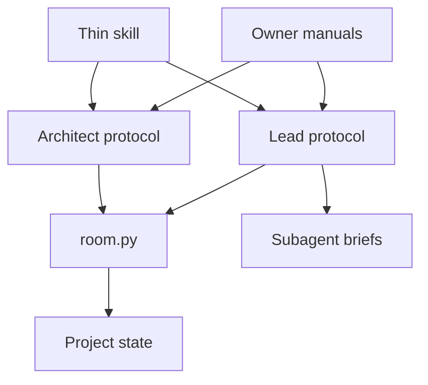

<h3>PR Summary by Qodo</h3>

Add pinned agent-room protocols, subagent briefs, and owner manuals

<!-- qodo-describe-risk-badge -->
<!-- /qodo-describe-risk-badge -->
<code>📝 Documentation</code> <code>✨ Enhancement</code> <code>🧪 Tests</code> <code>🕐 40+ Minutes</code>

<!-- qodo-describe-risk-slot -->

AI Description

<dl>
<dd>
 

><pre>
>• Define architect and lead protocols for planning, reviews, handovers, decisions, and recovery.
></pre>

</dd>
</dl>

Diagram

<dl>
<dd>

 

</dd>
</dl>

High-Level Assessment

<dl>
<dd>

 

>The following are alternative approaches to this PR:

<b>1. Keep all instructions in the skill</b>

<dl>
<dd>

- ➕ One document to distribute and read.
- ➖ Every procedural change requires replacing the saved skill.
- ➖ Harder to pin different projects to different protocol versions.

</dd>
</dl>

<b>2. Generate manuals from the protocols</b>

<dl>
<dd>

- ➕ Could reduce drift between owner instructions and agent procedures.
- ➖ Requires a documentation generator and source format not otherwise needed.
- ➖ May make short, owner-focused troubleshooting guidance harder to maintain.

</dd>
</dl>

>**Recommendation:** Keep the thin, version-pinned skill and separate role protocols: they support project-specific pins without repeatedly replacing the skill. The manually written owner pages are reasonable, but reviewers should check cross-document consistency; the new tests validate links, command syntax, and page structure rather than procedural correctness.

</dd>
</dl>

 Files changed (56) <code> +3537 / -278 </code> 

<dl>
<dd>

 

Enhancement (1) <code> +15 / -4 </code>

<dl>
<dd>

room.py<code>Check merge settings and shorten foreground waits</code> <code>+15/-4</code>

 

>Check merge settings and shorten foreground waits
>
><pre>
>• Makes preflight fail when merge commits are disabled, changes the default wait to 540 seconds, and clarifies cursor and takeover wording.
></pre>
>
><a href='https://github.com/SigorMatt/agent-room/pull/9/files#diff-36e706accba1fe5812fd1526e9931f792f8e314ada3f00e0e24e85cd44fb2433'>room.py</a>

</dd>
</dl>

Tests (3) <code> +299 / -2 </code>

<dl>
<dd>

fake_gh_state.py<code>Model merge commits in the fake GitHub repository</code> <code>+3/-2</code>

 

>Model merge commits in the fake GitHub repository
>
><pre>
>• Enables allow_merge_commit by default in the fake repository response used by state tests.
></pre>
>
><a href='https://github.com/SigorMatt/agent-room/pull/9/files#diff-6aa9adf56b470d1fdf237fccce1390505d2787d7e6e5509589e0704ad4e3e54a'>tests/fake_gh_state.py</a>

test_docs.py<code>Validate protocol and manual structure</code> <code>+273/-0</code>

 

>Validate protocol and manual structure
>
><pre>
>• Checks documented room.py commands with its own parser, relative links, required files, five-section manual pages, and index coverage.
></pre>
>
><a href='https://github.com/SigorMatt/agent-room/pull/9/files#diff-5c6dddc0c85981eb75bdb49d400e82c9271918e138990baba53ac34cbcf2aaac'>tests/test_docs.py</a>

test_state.py<code>Test the merge-commit preflight check</code> <code>+23/-0</code>

 

>Test the merge-commit preflight check
>
><pre>
>• Covers enabled, disabled, and unavailable allow_merge_commit settings for architect and lead preflight.
></pre>
>
><a href='https://github.com/SigorMatt/agent-room/pull/9/files#diff-5afca8e5f21c0b4ea0fdce909beeaf1b42de838e9f0543652d8584d71e1fcf7e'>tests/test_state.py</a>

</dd>
</dl>

Documentation (51) <code> +3222 / -272 </code>

<dl>
<dd>

SKILL.md<code>Reduce the skill to a pinned protocol loader</code> <code>+36/-124</code>

 

>Reduce the skill to a pinned protocol loader
>
><pre>
>• Replaces the earlier all-in-one instructions with role selection, version lookup, pinned downloads, and safety rules that remain in force if loading fails.
></pre>
>
><a href='https://github.com/SigorMatt/agent-room/pull/9/files#diff-7dcc95710d2eec6664574786a9d01b92d94822f644704261707e8c99202d7d73'>.claude/skills/agent-room/SKILL.md</a>

ARCHITECT.md<code>Define the architect&#x27;s operating protocol</code> <code>+434/-0</code>

 

>Define the architect&#x27;s operating protocol
>
><pre>
>• Covers project starts, state-branch ownership, design and playbook approval, phase kickoff, owner decisions, ACK checks, watchdogs, takeovers, upgrades, and account moves.
></pre>
>
><a href='https://github.com/SigorMatt/agent-room/pull/9/files#diff-ea2e7d73022c92135dc25cc66e267892824f32ecb823bb758697588c630d9cc1'>ARCHITECT.md</a>

CHANGELOG.md<code>Document the first release and migration</code> <code>+23/-0</code>

 

>Document the first release and migration
>
><pre>
>• Describes the unreleased v1.0.0 pipeline and identifies the owner&#x27;s skill and Project-instruction migration steps.
></pre>
>
><a href='https://github.com/SigorMatt/agent-room/pull/9/files#diff-06572a96a58dc510037d5efa622f9bec8519bc1beab13c9f251e97e657a9d4ed'>CHANGELOG.md</a>

LEAD.md<code>Define the lead&#x27;s mission and recovery protocol</code> <code>+419/-0</code>

 

>Define the lead&#x27;s mission and recovery protocol
>
><pre>
>• Specifies joining and leasing, check-ins, mission execution, review and merge gates, handover, phase completion, escalation, and resume behavior. Includes safeguards for stale pause/stop messages, weakened tests, and failure drills.
></pre>
>
><a href='https://github.com/SigorMatt/agent-room/pull/9/files#diff-0d7d95c154bdf0eaee1f65e13b353b2c0c4950ddce9c78849fbf72025b313c79'>LEAD.md</a>

README.md<code>Replace the old walkthrough with a pipeline overview</code> <code>+46/-142</code>

 

>Replace the old walkthrough with a pipeline overview
>
><pre>
>• Summarizes roles, versioning, principal room.py commands, safety boundaries, tests, and links to the new protocols and manuals.
></pre>
>
><a href='https://github.com/SigorMatt/agent-room/pull/9/files#diff-b335630551682c19a781afebcf4d07bf978fb1f8ac04c6bf87428ed5106870f5'>README.md</a>

auditor.md<code>Define review-disposition audit checks</code> <code>+50/-0</code>

 

>Define review-disposition audit checks
>
><pre>
>• Gives a fresh auditor the cold and Qodo evidence, disposition grammar, verification checklist, and exact report format.
></pre>
>
><a href='https://github.com/SigorMatt/agent-room/pull/9/files#diff-fc70ffa51c0e9c9a0137c10d9f247bba64bcf7ed4f613606a0634c5ddec70b0f'>briefs/auditor.md</a>

builder.md<code>Define isolated builder assignments</code> <code>+58/-0</code>

 

>Define isolated builder assignments
>
><pre>
>• Provides build and finding-fix variants, worktree and safety boundaries, and compact RESULT or QUESTION replies.
></pre>
>
><a href='https://github.com/SigorMatt/agent-room/pull/9/files#diff-89a2207eb531d8cc7587d7e27daedced5a5832a723891b3a1ed9716f712d7aaf'>briefs/builder.md</a>

cold-review.md<code>Define independent cold-review rounds</code> <code>+80/-0</code>

 

>Define independent cold-review rounds
>
><pre>
>• Specifies first, later, and scoped review variants with evidence, coverage, severity, and report requirements.
></pre>
>
><a href='https://github.com/SigorMatt/agent-room/pull/9/files#diff-45daae275277e9c59d041029852d2fae74eb2f0eb4bb3b9bba13cfb4332eb2b9'>briefs/cold-review.md</a>

planner.md<code>Define phase and additional-mission planning</code> <code>+64/-0</code>

 

>Define phase and additional-mission planning
>
><pre>
>• Requires a separate main clone, criterion and ledger coverage, bounded missions, and a structured proposal for the lead.
></pre>
>
><a href='https://github.com/SigorMatt/agent-room/pull/9/files#diff-d78af491cad7e68773869a464170dfd4f96d80e8e37b62ed86ff823d6f56d90e'>briefs/planner.md</a>

qodo-reader.md<code>Define Qodo review-reading variants</code> <code>+66/-0</code>

 

>Define Qodo review-reading variants
>
><pre>
>• Covers first reviews, later rounds, and final checks, including archived evidence, proposed dispositions, and Qodo-value measurements.
></pre>
>
><a href='https://github.com/SigorMatt/agent-room/pull/9/files#diff-80344ae0568fb4564885799503996dc02c0c87b0485ae8a5b929e6f3cf99eb5e'>briefs/qodo-reader.md</a>

survey.md<code>Define an existing-repository survey</code> <code>+95/-0</code>

 

>Define an existing-repository survey
>
><pre>
>• Directs a read-only subagent to inventory code, tests, dependencies, cloud limits, merge-hold paths, debt, and conflicts with a discussion digest.
></pre>
>
><a href='https://github.com/SigorMatt/agent-room/pull/9/files#diff-d3c8eaeb6fa550717fd87047d4342e84343884d10239787568920657a6d794e8'>briefs/survey.md</a>

BUILD-STATE.md<code>Record M5 readiness and platform findings</code> <code>+7/-5</code>

 

>Record M5 readiness and platform findings
>
><pre>
>• Marks M4 complete and M6 prepared, records approval-stall findings J and K, and closes the weakened-test hold decision.
></pre>
>
><a href='https://github.com/SigorMatt/agent-room/pull/9/files#diff-eb974eadcb2e1d4f382c2409c07a470b3df0574298ed8eda187eb1a6d7b1375f'>docs/design/BUILD-STATE.md</a>

v1.md<code>Align the ACK expectation with lead check-ins</code> <code>+1/-1</code>

 

>Align the ACK expectation with lead check-ins
>
><pre>
>• Changes the architect&#x27;s expected ACK window from about two minutes to about 30 minutes.
></pre>
>
><a href='https://github.com/SigorMatt/agent-room/pull/9/files#diff-2b52e99c393c109f0060898a48e99b807bac479fa6f867b8e9b985ed76357204'>docs/design/v1.md</a>

README.md<code>Index owner tasks by intent</code> <code>+55/-0</code>

 

>Index owner tasks by intent
>
><pre>
>• Adds an “I want to…” index linking every setup, run, maintenance, and reference page.
></pre>
>
><a href='https://github.com/SigorMatt/agent-room/pull/9/files#diff-5ff0bdf99e041da1e590db1f6b392ac119e5b981ebd320bc1afa73174e7f0424'>docs/manual/README.md</a>

answer-a-buzz.md<code>Explain responses to all seven buzzing message kinds</code> <code>+130/-0</code>

 

>Explain responses to all seven buzzing message kinds
>
><pre>
>• Guides decisions, holds, missing leads, pause/stop completion, phase completion, and silent-lead recovery, including ACK follow-up.
></pre>
>
><a href='https://github.com/SigorMatt/agent-room/pull/9/files#diff-d3a70a640b14f1436419811a13d5e127a067c49ce42446d9f02bf5cbe82b2419'>docs/manual/answer-a-buzz.md</a>

approve-the-playbook.md<code>Guide playbook approval</code> <code>+47/-0</code>

 

>Guide playbook approval
>
><pre>
>• Lists the criteria, test, merge holds, environment needs, discretion, and budget the owner should approve before kickoff.
></pre>
>
><a href='https://github.com/SigorMatt/agent-room/pull/9/files#diff-2a406258863c67bd466bb16cc082d24cc838d9e29dc2c6e8c5a61959bfe53e8d'>docs/manual/approve-the-playbook.md</a>

change-something-mid-build.md<code>Guide mid-phase design changes</code> <code>+33/-0</code>

 

>Guide mid-phase design changes
>
><pre>
>• Explains applying a CHANGE immediately or from the next mission and waiting for the lead&#x27;s ACK.
></pre>
>
><a href='https://github.com/SigorMatt/agent-room/pull/9/files#diff-369bb6f3459db17b6117ab349e7325150d7a4dce4df2ddd3bb8146df908e6fd8'>docs/manual/change-something-mid-build.md</a>

connect-github.md<code>Guide GitHub connection in each account</code> <code>+29/-0</code>

 

>Guide GitHub connection in each account
>
><pre>
>• Covers Claude authorization, repository access, and diagnosis when a session cannot see a repository.
></pre>
>
><a href='https://github.com/SigorMatt/agent-room/pull/9/files#diff-8154889995885f6b7fba83bf38c16a36a548ea9c97f157fff7749bb9ff40954e'>docs/manual/connect-github.md</a>

create-the-claude-project.md<code>Set up the architect&#x27;s Claude Project</code> <code>+37/-0</code>

 

>Set up the architect&#x27;s Claude Project
>
><pre>
>• Provides the Project instructions and a first-line check that its architect protocol loaded.
></pre>
>
><a href='https://github.com/SigorMatt/agent-room/pull/9/files#diff-899c401420420e1783f58c938ec2bbf61d810eb5df2ad1e34d1834ea705f6b67'>docs/manual/create-the-claude-project.md</a>

create-the-cloud-environment.md<code>Configure the shared cloud environment</code> <code>+49/-0</code>

 

>Configure the shared cloud environment
>
><pre>
>• Explains allowed domains, ntfy and Qodo variables, and the environment used by leads and watchdogs.
></pre>
>
><a href='https://github.com/SigorMatt/agent-room/pull/9/files#diff-66b0fc08934275ec3c4bae3d4f28a35e81ba259ebabc3f7bb83090a7e87915c0'>docs/manual/create-the-cloud-environment.md</a>

create-the-repo.md<code>Configure a project repository for missions</code> <code>+37/-0</code>

 

>Configure a project repository for missions
>
><pre>
>• Covers repository creation, automatic merged-branch deletion, merge commits, app access, and compatible branch protection.
></pre>
>
><a href='https://github.com/SigorMatt/agent-room/pull/9/files#diff-6997127bf7e52734a363f5ddac94cf980de9bedeab58ec4bf470a63c235ed48a'>docs/manual/create-the-repo.md</a>

files-and-owners.md<code>Map pipeline files to branches and owners</code> <code>+48/-0</code>

 

>Map pipeline files to branches and owners
>
><pre>
>• Identifies code, state, and review-record locations and which participant edits each state file.
></pre>
>
><a href='https://github.com/SigorMatt/agent-room/pull/9/files#diff-f47b2b54518102b933d7e64a9a1b8f5d81f1c27151b2e8c3f08f2d1e0fc8180f'>docs/manual/files-and-owners.md</a>

fix-preflight.md<code>Provide owner fixes for preflight findings</code> <code>+66/-0</code>

 

>Provide owner fixes for preflight findings
>
><pre>
>• Maps failed and warning checks to repository or environment settings, including the new merge-commit check.
></pre>
>
><a href='https://github.com/SigorMatt/agent-room/pull/9/files#diff-70474326c08096752223a06cfb28f4179eb1b2f1799e2c51d84204fccc07ec9c'>docs/manual/fix-preflight.md</a>

glossary.md<code>Define pipeline terms for the owner</code> <code>+52/-0</code>

 

>Define pipeline terms for the owner
>
><pre>
>• Explains roles, rooms, missions, state, leases, versions, reviews, and notifications in plain language.
></pre>
>
><a href='https://github.com/SigorMatt/agent-room/pull/9/files#diff-ab49e26773cd11b72502ca499f805f8e87462242295c83306982316c497a2c7f'>docs/manual/glossary.md</a>

handle-ntfy-limit-errors.md<code>Explain failed notification recovery</code> <code>+38/-0</code>

 

>Explain failed notification recovery
>
><pre>
>• Distinguishes failed buzzes from posted messages and covers ntfy 403/429 errors and paid-token setup.
></pre>
>
><a href='https://github.com/SigorMatt/agent-room/pull/9/files#diff-ff7c80a734760ff299bba92fe688a51c2c2d6b535e6d19f082b294b574d4f545'>docs/manual/handle-ntfy-limit-errors.md</a>

install-ntfy-and-subscribe.md<code>Set up a private phone notification topic</code> <code>+30/-0</code>

 

>Set up a private phone notification topic
>
><pre>
>• Explains subscription, topic secrecy, delivery settings, and replacing a leaked topic.
></pre>
>
><a href='https://github.com/SigorMatt/agent-room/pull/9/files#diff-d9aaa13174ed26283e3b2ab6f3e50e008e80f9f686c2f0d6da88b44f49614a14'>docs/manual/install-ntfy-and-subscribe.md</a>

judge-qodo-and-switch-it-off.md<code>Help the owner assess Qodo&#x27;s value</code> <code>+48/-0</code>

 

>Help the owner assess Qodo&#x27;s value
>
><pre>
>• Explains QODO-VALUE measurements and the order for disabling reviews without triggering repeated missing-review holds.
></pre>
>
><a href='https://github.com/SigorMatt/agent-room/pull/9/files#diff-a9887f64ba2fbd64b717860311ef013ac386fee7d4189c826789270aea915d5f'>docs/manual/judge-qodo-and-switch-it-off.md</a>

kick-off-a-phase.md<code>Guide phase kickoff from the phone</code> <code>+45/-0</code>

 

>Guide phase kickoff from the phone
>
><pre>
>• Covers room and watchdog creation, preflight, environment confirmation, the join line, and first-lead expectations.
></pre>
>
><a href='https://github.com/SigorMatt/agent-room/pull/9/files#diff-e53a7e559d2c268d2a27b08a3353ce0730b95cdee1237f8611c589eb4703788b'>docs/manual/kick-off-a-phase.md</a>

make-agent-room-public.md<code>Explain public access to pinned downloads</code> <code>+42/-0</code>

 

>Explain public access to pinned downloads
>
><pre>
>• Shows how to make the pipeline repository public and verify unauthenticated access to room.py.
></pre>
>
><a href='https://github.com/SigorMatt/agent-room/pull/9/files#diff-302ff42356f4bd25ccb19bb9902d3935adc5f20aacc37f4eddba4d98ae62d76b'>docs/manual/make-agent-room-public.md</a>

merge-hold-list.md<code>Explain merge-hold reasons and sensitive areas</code> <code>+43/-0</code>

 

>Explain merge-hold reasons and sensitive areas
>
><pre>
>• Defines the six hold reasons, default sensitive paths, and how the owner changes or answers a hold.
></pre>
>
><a href='https://github.com/SigorMatt/agent-room/pull/9/files#diff-685946f8f4f43d705ba6cc5573fb8ecbec47aef546962109c86f4f6df839c880'>docs/manual/merge-hold-list.md</a>

message-kinds.md<code>Catalog room messages and buzz behavior</code> <code>+45/-0</code>

 

>Catalog room messages and buzz behavior
>
><pre>
>• Lists senders, notifications, meanings, and owner actions for lead, architect, and watchdog messages.
></pre>
>
><a href='https://github.com/SigorMatt/agent-room/pull/9/files#diff-09cb0a2e151eb8b9ccf8fcf259fac66b6f8b7bac0b9ac7fbf08a92c6668fd328'>docs/manual/message-kinds.md</a>

move-a-project-to-the-other-account.md<code>Guide migration between Claude accounts</code> <code>+50/-0</code>

 

>Guide migration between Claude accounts
>
><pre>
>• Sequences pausing, old-watchdog deletion, handoff, new-watchdog creation, and a lead start in the other account.
></pre>
>
><a href='https://github.com/SigorMatt/agent-room/pull/9/files#diff-ea789efa04a80b7638a4742f6e41f3d90120b1f7a17e8ecbfadabfc132841283'>docs/manual/move-a-project-to-the-other-account.md</a>

read-the-state-branch.md<code>Show where to inspect project state</code> <code>+46/-0</code>

 

>Show where to inspect project state
>
><pre>
>• Points the owner to playbook, design, missions, ledger, Qodo history, and review records on their respective branches.
></pre>
>
><a href='https://github.com/SigorMatt/agent-room/pull/9/files#diff-0e43499d3c324b44526914991ae962a52a842aa1d2e39cb800b660c4b34c40ea'>docs/manual/read-the-state-branch.md</a>

report-a-pipeline-problem.md<code>Standardize pipeline issue reports</code> <code>+42/-0</code>

 

>Standardize pipeline issue reports
>
><pre>
>• Provides an issue template for pipeline faults and manual gaps while warning against exposing secrets or labeling reports as rooms.
></pre>
>
><a href='https://github.com/SigorMatt/agent-room/pull/9/files#diff-15d3d3dca217dd4ff162b70db18356eb4c21e619998ca03605b633e138440bdc'>docs/manual/report-a-pipeline-problem.md</a>

save-the-skill.md<code>Explain installing the thin skill</code> <code>+39/-0</code>

 

>Explain installing the thin skill
>
><pre>
>• Covers saving the skill in each account, an upload fallback, and checks that it is enabled.
></pre>
>
><a href='https://github.com/SigorMatt/agent-room/pull/9/files#diff-887de470d39138e2ecea7e374ccb6797726976abdfb113dcf6473cd7cf5e6aa6'>docs/manual/save-the-skill.md</a>

set-up-environment-needs.md<code>Guide domain and network-secret setup</code> <code>+41/-0</code>

 

>Guide domain and network-secret setup
>
><pre>
>• Explains translating playbook requirements into allowed domains and per-website network secrets without pasting credentials into chats.
></pre>
>
><a href='https://github.com/SigorMatt/agent-room/pull/9/files#diff-74a80a5972c971f281c976233271ee0280ebd1c1fdc1264971f5ee17f5b35bd6'>docs/manual/set-up-environment-needs.md</a>

start-a-new-phase.md<code>Guide planning after phase completion</code> <code>+38/-0</code>

 

>Guide planning after phase completion
>
><pre>
>• Sequences a fresh architect chat, playbook approval, environment changes, and the next room and lead.
></pre>
>
><a href='https://github.com/SigorMatt/agent-room/pull/9/files#diff-285ad703cd2573cf711110e8c3ab6bd3b08ce5e94c68d201531efae98862576e'>docs/manual/start-a-new-phase.md</a>

start-from-a-discussion-plus-code.md<code>Guide adoption of an existing codebase</code> <code>+36/-0</code>

 

>Guide adoption of an existing codebase
>
><pre>
>• Adds the survey and disagreement-resolution steps to the earlier-discussion starting path.
></pre>
>
><a href='https://github.com/SigorMatt/agent-room/pull/9/files#diff-73c4e7e2a684b4c6eeb2ad87508c4a57eb774b05aa80da844c0d1d51f10b531e'>docs/manual/start-from-a-discussion-plus-code.md</a>

start-from-a-discussion.md<code>Guide an earlier-chat handoff</code> <code>+50/-0</code>

 

>Guide an earlier-chat handoff
>
><pre>
>• Explains committing a digest in the old chat before continuing the design in the project&#x27;s Claude Project.
></pre>
>
><a href='https://github.com/SigorMatt/agent-room/pull/9/files#diff-bf6b97b312fc760a528bd74081d8176a419d4b508e20433c663c663b8d540ca7'>docs/manual/start-from-a-discussion.md</a>

start-from-scratch.md<code>Guide new-project design and kickoff</code> <code>+40/-0</code>

 

>Guide new-project design and kickoff
>
><pre>
>• Takes the owner from an empty repository through design, playbook approval, environment needs, and first phase.
></pre>
>
><a href='https://github.com/SigorMatt/agent-room/pull/9/files#diff-29b7cc78452c57483c8416c764ceb8166ed56788d17ffd496f6e4edd9fb659c4'>docs/manual/start-from-scratch.md</a>

start-the-next-lead-by-hand.md<code>Distinguish normal joins from takeovers</code> <code>+51/-0</code>

 

>Distinguish normal joins from takeovers
>
><pre>
>• Explains when to request each join line, archive an old session, and diagnose a held lease.
></pre>
>
><a href='https://github.com/SigorMatt/agent-room/pull/9/files#diff-294f11d2c7ddbfe0d2f72e13a052c6475345433ac8485de5ec27469ed827fd77'>docs/manual/start-the-next-lead-by-hand.md</a>

steer-from-github.md<code>Explain trusted owner comments in the room</code> <code>+56/-0</code>

 

>Explain trusted owner comments in the room
>
><pre>
>• Shows how to pause, stop, or send an in-scope instruction directly from GitHub and when to use the architect instead.
></pre>
>
><a href='https://github.com/SigorMatt/agent-room/pull/9/files#diff-b2a7cfa50633b9936ed7de2de54d861c00263d40b35edf881c4b4c94b68fee3a'>docs/manual/steer-from-github.md</a>

stop-or-pause.md<code>Guide safe pause, stop, and resume</code> <code>+46/-0</code>

 

>Guide safe pause, stop, and resume
>
><pre>
>• Distinguishes the two interruption modes, their completion buzzes, and resuming with a normal join line.
></pre>
>
><a href='https://github.com/SigorMatt/agent-room/pull/9/files#diff-389465ea269a845490df59482a40f4cc1ec6d5e684754f35eba1781d11caac47'>docs/manual/stop-or-pause.md</a>

test-the-buzz.md<code>Provide an end-to-end notification check</code> <code>+41/-0</code>

 

>Provide an end-to-end notification check
>
><pre>
>• Gives a cloud-session ping procedure and diagnoses missing topics, blocked domains, rate limits, and delivery issues.
></pre>
>
><a href='https://github.com/SigorMatt/agent-room/pull/9/files#diff-832f049d6ef4d95090ad78cd405a14f2dabcab1284c674c83752735834b9d919'>docs/manual/test-the-buzz.md</a>

troubleshooting.md<code>Collect common pipeline failure remedies</code> <code>+67/-0</code>

 

>Collect common pipeline failure remedies
>
><pre>
>• Maps loading, notification, lease, drill, branch, and merge symptoms to owner actions and further guidance.
></pre>
>
><a href='https://github.com/SigorMatt/agent-room/pull/9/files#diff-bfec8ea3d3009f9d7d15f1153d8a9db48d7c0e60aa0343ad065af35765dbc2e4'>docs/manual/troubleshooting.md</a>

upgrade-a-project.md<code>Define patch and full-upgrade procedures</code> <code>+59/-0</code>

 

>Define patch and full-upgrade procedures
>
><pre>
>• Distinguishes an in-place patch pin bump from a paused minor or major migration with new sessions.
></pre>
>
><a href='https://github.com/SigorMatt/agent-room/pull/9/files#diff-223e997fc73050942a003e4dde0ae6d39108c325aaebf12a65f8d86367b793ea'>docs/manual/upgrade-a-project.md</a>

wrap-up-an-architect-session.md<code>Guide architect session handoff</code> <code>+41/-0</code>

 

>Guide architect session handoff
>
><pre>
>• Explains committing HANDOFF.md before rotating to a fresh Project chat.
></pre>
>
><a href='https://github.com/SigorMatt/agent-room/pull/9/files#diff-0a0d2eefd8adc53538288d66a8edf6a0928668ed5ef56bdf9f32c9602a913b05'>docs/manual/wrap-up-an-architect-session.md</a>

DISPOSITIONS.md<code>Record dispositions for 36 cold-review findings</code> <code>+40/-0</code>

 

>Record dispositions for 36 cold-review findings
>
><pre>
>• Links both rounds&#x27; findings to fixes and evidence, including recovery, budget, review, and merge-hold protocol corrections.
></pre>
>
><a href='https://github.com/SigorMatt/agent-room/pull/9/files#diff-431857fdd84d426b0dcd31da0b9077442cc5e0e66cac2ed5838f87a3946ad09c'>reviews/cold/M5/DISPOSITIONS.md</a>

round-1.md<code>Archive the first M5 cold review</code> <code>+90/-0</code>

 

>Archive the first M5 cold review
>
><pre>
>• Records 22 findings, criterion coverage, and scope observations for the initial protocols and manuals.
></pre>
>
><a href='https://github.com/SigorMatt/agent-room/pull/9/files#diff-b06a3cd8172c306136fa00e592997842e8cc783ba8fdbd7b7d32ddd817551976'>reviews/cold/M5/round-1.md</a>

round-2.md<code>Archive the second M5 cold review</code> <code>+94/-0</code>

 

>Archive the second M5 cold review
>
><pre>
>• Records 14 further findings, checks earlier fixes, and documents remaining scope observations.
></pre>
>
><a href='https://github.com/SigorMatt/agent-room/pull/9/files#diff-fb2ec06ca6c4d8711c36aac29e577bb91c35696bbb778e8b3eb9d724d578a41a'>reviews/cold/M5/round-2.md</a>

PLAYBOOK.md<code>Clarify environment-needs entries</code> <code>+2/-0</code>

 

>Clarify environment-needs entries
>
><pre>
>• Adds template guidance for each domain&#x27;s purpose and the website, header, and value prefix of network secrets.
></pre>
>
><a href='https://github.com/SigorMatt/agent-room/pull/9/files#diff-2f9618754fe5519d3a54cca83efd0b37f9f8df4e7a9e806cf1c13a2b3255a5e1'>templates/playbook/PLAYBOOK.md</a>

</dd>
</dl>

Other (1) <code> +1 / -0 </code>

<dl>
<dd>

STABLE<code>Set the initial version for new projects</code> <code>+1/-0</code>

 

>Set the initial version for new projects
>
><pre>
>• Names main as the version new projects use until the first release tag.
></pre>
>
><a href='https://github.com/SigorMatt/agent-room/pull/9/files#diff-0436ac5f0b422251d1a7576a8ef3e7af6f1f9ef86af4a0641ff2584b3bac0c50'>STABLE</a>

</dd>
</dl>

</dd>
</dl>

<!-- qodo-describe-head:ea8170ab0d5c3b3e66fe3e5500e13b6918ed4b37 -->